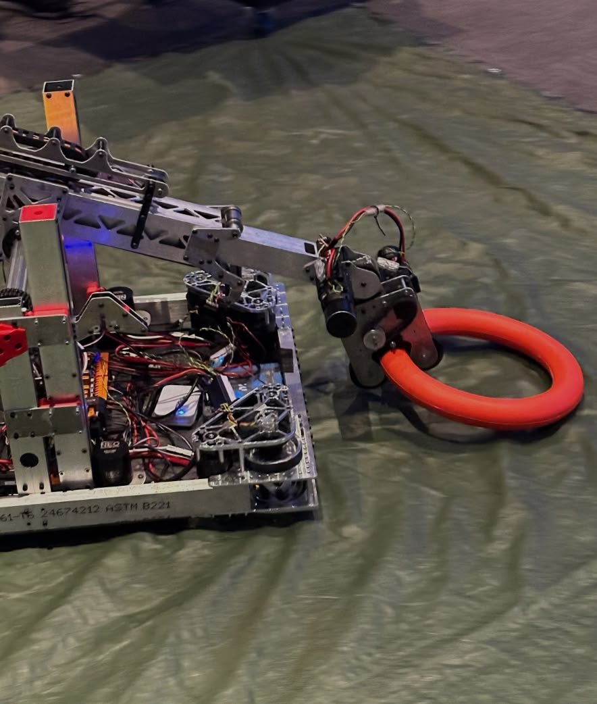
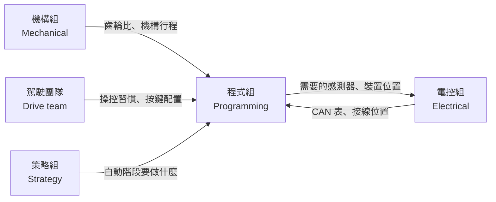

# 第 0 章 開始之前

歡迎加入 FRC 程式組！這章不寫程式，先帶你了解 FRC 是什麼、程式組在隊上負責什麼，以及這份教學要怎麼讀。

## 這章學什麼

- 知道 FRC 比賽的基本流程
- 知道程式組要負責哪些事
- 知道程式組要和哪些人合作

## FRC 是什麼

**FIRST Robotics Competition (FRC)** 是給高中生參加的機器人競賽。每年一月 **Kickoff（賽季開幕）** 時公布當年的比賽題目，各隊要在幾週內設計、製作、寫程式，做出一台能完成任務的機器人，接著參加區域賽，成績好的隊伍可以晉級世界賽。

每年的題目都不一樣，但比賽的基本形式差不多：

- **Alliance（聯盟）**：每場比賽是紅、藍兩個聯盟對戰，每個聯盟 3 支隊伍
- **Autonomous period（自動階段）**：比賽一開始的十幾秒，機器人完全照程式自己動，駕駛不能操控
- **Teleoperated period（手動階段，簡稱 Teleop）**：剩下的時間由駕駛用手把操控
- **Endgame（終局）**：比賽最後的一段時間，通常有額外的得分任務

<figure markdown="span">
  { loading=lazy }
  <figcaption>FRC 9450 隊 2024 年的機器人。每年的題目不同，機器人的樣子也完全不一樣</figcaption>
</figure>

!!! tip "小技巧"
    每年的詳細規則寫在 **Game Manual（賽季手冊）** 裡。Kickoff 那天程式組也要一起讀，因為規則會直接影響自動階段要做什麼、機器人需要哪些功能。

## 程式組在做什麼

機構組把機器人做出來，電控組把線接好，但機器人要「動起來」，靠的是程式組。程式組負責：

| 工作 | 例子 |
| --- | --- |
| **讓駕駛能操控機器人** | 推搖桿底盤就前進、按按鈕 Intake 就吸球 |
| **寫自動階段** | 機器人自己走到指定位置、自動得分 |
| **讓機構動得準** | 手臂停在指定角度、發射器維持固定轉速 |
| **整合感測器和視覺** | 用相機辨識目標、自動對準 |
| **除錯和維護** | 比賽中機器人出問題時，找出原因並修好 |

程式組的成果是**一個軟體專案**，但它控制的是真實世界的機器。程式寫錯了，可能讓機構撞壞，甚至讓人受傷。所以這份教學會一直提醒你**安全**。

## 程式組和誰合作

程式組很少能自己埋頭寫程式。你需要知道機構的齒輪比才能算出轉速，需要電控組的 CAN 表才能找到馬達，需要駕駛的意見才知道按鍵怎麼配最順手。**多問、多溝通**是程式組最重要的能力之一。

## 本章內容

| 小節 | 內容 |
| --- | --- |
| [這份教學怎麼讀](how-to-read.md) | 依程度選擇閱讀路線、每頁的固定結構 |
| [延伸學習](further.md) | FIRST 官方資源、社群 |
