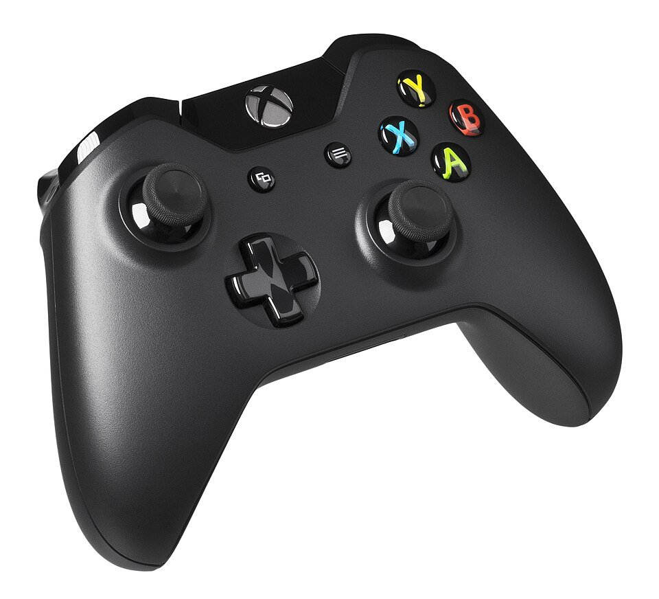

# Driver Station 與手把

--8<-- "alpha-warning.md"

## 這頁學什麼

- Driver Station 是什麼、做什麼用
- 機器人有哪些模式，誰決定現在是哪個模式
- 常見手把的按鍵在程式裡怎麼稱呼

## 觀念

### Driver Station（操控站）

**Driver Station** 是裝在筆電上的程式，駕駛透過它控制機器人。它負責：

- **Enable / Disable（啟用 / 停用）**：機器人只有在 Enable 時才會動
- **選擇模式**：Autonomous（自動）、Teleop（手動）等
- **傳送手把輸入**：讀取接在筆電上的手把，傳給機器人
- **顯示狀態**：電池電壓、連線狀態、錯誤訊息

2027 起使用新版的 **FIRST Driver Station**，支援多種作業系統，只能搭配 Systemcore 使用（不支援 roboRIO）。

!!! warning "注意：Enable 前先確認周圍"
    按下 Enable 的瞬間，機器人可能馬上開始動。按之前一定要大聲喊「Enable！」，確認機器人周圍沒有人、機器人有架高或有足夠空間。緊急時按 ++space++ 可以立即停用機器人（以 2027 版 Driver Station 實際的按鍵設定為準）。

### 機器人模式

| 模式 | 說明 |
| --- | --- |
| Disabled（停用） | 機器人不會動，程式仍在執行 |
| Autonomous（自動） | 比賽開始的自動階段，機器人依程式自己動作，駕駛不能控制 |
| Teleop（手動） | 駕駛用手把操控 |
| Utility（工具） | 測試和維修用（2026 以前叫 Test） |

練習時由 Driver Station 切換模式；正式比賽時，模式由場地系統 (FMS, Field Management System) 控制，所有機器人同時切換。

程式要針對每個模式寫不同的行為，這是 [第 4 章 程式的生命週期](../04-robot-basics/lifecycle.md) 的主題。

### 連線

練習時，筆電可以用 USB、網路線，或 Systemcore 自己的 Wi-Fi 熱點連上機器人。正式比賽的連線方式由場地提供，以 2027 賽季手冊為準。

### 手把

FRC 最常用的是 Xbox 手把，PS4 / PS5 手把也可以用。程式讀手把時會用到兩種輸入：

- **Axis（軸）**：搖桿和板機，數值是連續的，例如 -1.0 到 1.0
- **Button（按鈕）**：只有按下 / 放開兩種狀態

<figure markdown="span">
  { width="960" height="872" }
  <figcaption>Xbox One 手把：兩支搖桿和前方的板機是 Axis，右側 A / B / X / Y 和其他按鈕是 Button</figcaption>
</figure>

!!! info "2027 新改動：通用手把類別用方向命名按鈕"
    WPILib 2027 新增了通用的 `Gamepad` 類別，右側四顆按鈕用**位置**命名：`faceUp`、`faceDown`、`faceLeft`、`faceRight`。這樣不管用 Xbox 還是 PS 手把，同一個位置的按鈕在程式裡名稱都一樣。

    專用的 `XboxController` 類別仍然使用 A / B / X / Y 的名稱。兩種名稱的對照：

    | `Gamepad` | Xbox | PlayStation |
    | --- | --- | --- |
    | `faceDown` | A | ✕ |
    | `faceRight` | B | ○ |
    | `faceLeft` | X | □ |
    | `faceUp` | Y | △ |

**Deadband（死區）**：搖桿放開時，讀到的值通常不是剛好 0，而是 0.03 之類的小數字。如果直接拿來控制馬達，機器人會慢慢飄。死區就是「小於某個值就當作 0」。WPILib 2027 的手把類別預設就有死區。

## 動手看看

- [ ] 把手把接上筆電，在 Driver Station 裡找到手把的即時輸入畫面
- [ ] 推動搖桿，觀察 Axis 數值的範圍和方向（往上推是正還是負？）
- [ ] 按下每個按鈕，對照上面的表格

## 常見錯誤

!!! bug "常見錯誤：搖桿往上推是負數"
    大部分手把的左搖桿**往上推讀到的是負值**。直接拿來控制底盤前進，機器人會往後跑。程式裡通常要加一個負號。

!!! bug "常見錯誤：手把順序跑掉"
    接兩支手把時，Driver Station 會依序編號為 0、1。拔掉重插後順序可能改變，主駕駛和副駕駛的手把就對調了。上場前要在 Driver Station 確認手把順序。

## 小練習

1. 為什麼比賽時是由場地系統控制模式，而不是讓各隊自己按 Enable？
2. 搖桿放開時讀到 0.04，你的死區應該設多少？設太大會有什麼問題？

??? question "第 1 題參考答案"
    比賽要公平、安全：所有機器人要在**同一個時間**開始自動階段、同一個時間切換到手動階段、同一個時間停止。如果讓各隊自己按，有人早按、有人晚按，比賽就不公平；比賽結束或發生危險時，場地也要能一次停止所有機器人。

??? question "第 2 題參考答案"
    死區要比放開時的讀值大一些，例如 **0.05～0.1**（WPILib 2027 的 `Gamepad` 預設 0.1）。

    設太大的問題：搖桿要推很多才會有反應，低速時很難微調，例如對準目標時只想慢慢移動一點點，卻一下子就跳到很快。
