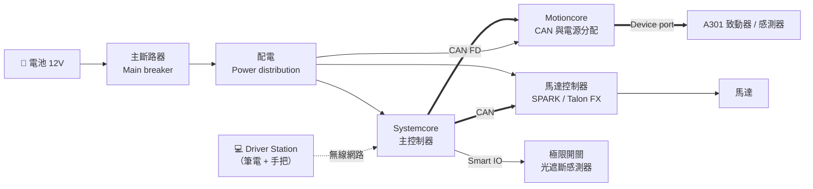

# 第 2 章 FRC 基本元件認識

--8<-- "alpha-warning.md"

寫程式之前，要先知道程式在控制什麼。這章會帶你認識 FRC 機器人上的主要電子元件：每個元件負責什麼、怎麼接在一起、程式又是怎麼跟它們溝通的。

## 這章學什麼

- 說出 FRC 機器人控制系統裡每個主要元件的功能
- 看懂元件之間的接線關係：哪些是電源線、哪些是訊號線
- 分辨 REV 和 CTRE 的常見產品
- 知道程式要用哪些資訊（例如 CAN ID、連接埠）才能控制一個裝置

**需要先讀**：不用。這章不寫程式，任何人都可以讀，機構組和電控組的同學也很適合。

## 控制系統全貌

先看整台機器人的大方向，細節後面每一頁會講。

圖裡有兩種線：

- **電源**：從電池出發，經過斷路器和配電，把電送到每個元件。
- **訊號**：Systemcore 透過 CAN、Smart IO 等方式，送指令給其他元件、讀回感測器資料。

程式只負責**訊號**這條路。不過電源沒接好，程式寫得再對機器人也不會動，所以程式組一定要知道電源怎麼走。

!!! info "2027 新改動"
    2026 以前的主控制器是 **roboRIO**。2027 換成 **Systemcore**，CAN 匯流排從 1 條變成多條，還多了 **Motioncore** 這個新裝置。用過舊系統的人，這章值得從頭讀一次。

## 本章內容

| 小節 | 內容 |
| --- | --- |
| [Systemcore 主控制器](systemcore.md) | 機器人的大腦，你的程式在這裡執行 |
| [電源與 Motioncore](power.md) | 電從哪裡來、怎麼分配 |
| [馬達與馬達控制器](motors.md) | 讓機器人動起來的元件，REV / CTRE 比較 |
| [感測器](sensors.md) | 讓機器人知道自己的狀態 |
| [Driver Station 與手把](driver-station.md) | 駕駛怎麼控制機器人 |
| [延伸學習](further.md) | 官方規格書、接線規則 |
