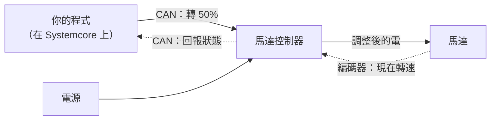

# 馬達與馬達控制器

--8<-- "alpha-warning.md"

## 這頁學什麼

- 馬達和馬達控制器的分工
- 有刷馬達和無刷馬達的差別
- 認識 REV 和 CTRE 的常見產品
- 程式要怎麼「找到」一顆馬達

## 觀念

### 馬達和馬達控制器

**Motor（馬達）** 負責把電變成轉動。但馬達自己不會判斷要轉多快，它只會照著收到的電轉。

**Motor controller（馬達控制器）** 夾在電源和馬達中間，收到程式的指令後，決定要送多少電、往哪個方向送給馬達。

現在的馬達控制器不只會轉馬達，還會**回報資料**：轉速、位置、電流、溫度。很多控制器甚至可以自己在內部跑 PID 控制（[第 8 章](../08-control/index.md) 會講），程式只要告訴它目標就好。

### 有刷和無刷

| | Brushed motor（有刷馬達） | Brushless motor（無刷馬達） |
| --- | --- | --- |
| 原理 | 用碳刷切換電流方向 | 由控制器用電子方式切換 |
| 效率、功率 | 較低 | 較高 |
| 需要的控制器 | 一般馬達控制器 | 支援無刷的控制器 |
| 常見用途 | 小機構、舊機器人 | 底盤、手臂、發射器等主要機構 |

現在 FRC 的主要機構幾乎都用無刷馬達。

### REV 和 CTRE 的常見產品

FRC 最常見的兩家廠商是 **REV Robotics** 和 **CTR Electronics (CTRE)**。兩家的程式寫法不一樣，這份教學在需要的地方都會並排兩種寫法。

=== "REV"

    REV 的馬達和控制器是**分開的**：馬達接到控制器上，控制器再接到 CAN。

    | 產品 | 種類 | 說明 |
    | --- | --- | --- |
    | NEO | 無刷馬達 | 最常見的 REV 馬達 |
    | NEO Vortex | 無刷馬達 | 比 NEO 更強，可以直接插在 SPARK Flex 上 |
    | NEO 550 | 無刷馬達 | 體積小，用在輕負載機構 |
    | SPARK MAX | 馬達控制器 | 可接有刷或無刷馬達 |
    | SPARK Flex | 馬達控制器 | 搭配 NEO Vortex 使用 |

    - **程式函式庫**：REVLib
    - **設定工具**：REV Hardware Client 2

=== "CTRE"

    CTRE 主流的馬達是**控制器內建在馬達裡**（Talon FX），一顆馬達就是一個 CAN 裝置。

    | 產品 | 種類 | 說明 |
    | --- | --- | --- |
    | Kraken X60 | 無刷馬達 + 內建 Talon FX | 目前最常見的 CTRE 馬達 |
    | Kraken X44 | 無刷馬達 + 內建 Talon FX | 比 X60 小 |
    | Falcon 500 | 無刷馬達 + 內建 Talon FX | 較舊的型號 |
    | Talon FXS | 馬達控制器 | 外接馬達用（例如 Minion 馬達） |

    - **程式函式庫**：Phoenix 6
    - **設定工具**：Phoenix Tuner X

### A301 致動器

**A301** 是 2027 新出現的 FIRST 致動器 (Actuator)，接在 [Motioncore](power.md) 的 Device port 上。目前透過 REVLib 提供程式支援，WPILib 之後也會直接支援。

!!! info "尚未確認"
    A301 的完整規格和比賽使用規則還沒有正式公布，這段會在資料公布後補上。

### 程式怎麼找到一顆馬達

程式要控制一顆 CAN 馬達控制器，至少需要知道兩件事：

1. **它接在哪一條 CAN 匯流排**（例如 Systemcore 的 `can_s0`，或 Motioncore 的 `can_d3`）
2. **它的 CAN ID**（同一條匯流排上不能重複）

所以接線完成後，電控組和程式組要一起整理一張 **CAN 表**：

| 機構 | 裝置 | 匯流排 | CAN ID |
| --- | --- | --- | --- |
| 底盤左前 | Kraken X60 | `can_s0` | 1 |
| 底盤右前 | Kraken X60 | `can_s0` | 2 |
| Intake | NEO + SPARK MAX | `can_s1` | 10 |
| … | … | … | … |

實際的程式寫法在 [第 4 章 讓馬達轉起來](../04-robot-basics/first-motor.md) 和 [第 6 章](../06-motors-sensors/index.md)。

!!! info "2027 新改動：PWM 馬達控制器"
    2027 起 WPILib 移除了 `Talon`、`VictorSP` 等舊的 PWM 馬達控制器類別，因為它們不符合 2027 的比賽規定。新機器人請使用 CAN 馬達控制器。

## 動手看看

- [ ] 在隊上找到 REV 和 CTRE 的馬達各一顆，分辨控制器是內建還是外接
- [ ] 找出機器人上哪些馬達是有刷、哪些是無刷
- [ ] 跟電控組要一份 CAN 表；沒有的話，跟他們一起做一份

## 常見錯誤

!!! bug "常見錯誤：兩個裝置用同一個 CAN ID"
    同一條匯流排上兩個同類型裝置用了相同的 CAN ID，會讓其中一個（或兩個）無法正常控制，有時候還會互相干擾，看起來像是馬達亂動。新裝置拿到手後要**先設定 CAN ID 再裝上機器人**。

!!! bug "常見錯誤：程式寫的廠商和實際裝置不一樣"
    把 SPARK MAX 當成 Talon FX 來寫，程式可以編譯，但馬達不會動。看 CAN 表確認每個裝置的型號。

## 小練習

1. 為什麼 CTRE 的 Kraken X60 只需要接一條 CAN 線，REV 的 NEO 卻要先接到 SPARK MAX？
2. 為下面這台機器人做一份 CAN 表：4 顆 Kraken X60 底盤馬達、1 顆 NEO Vortex 發射器、2 顆 NEO 550 Intake。
