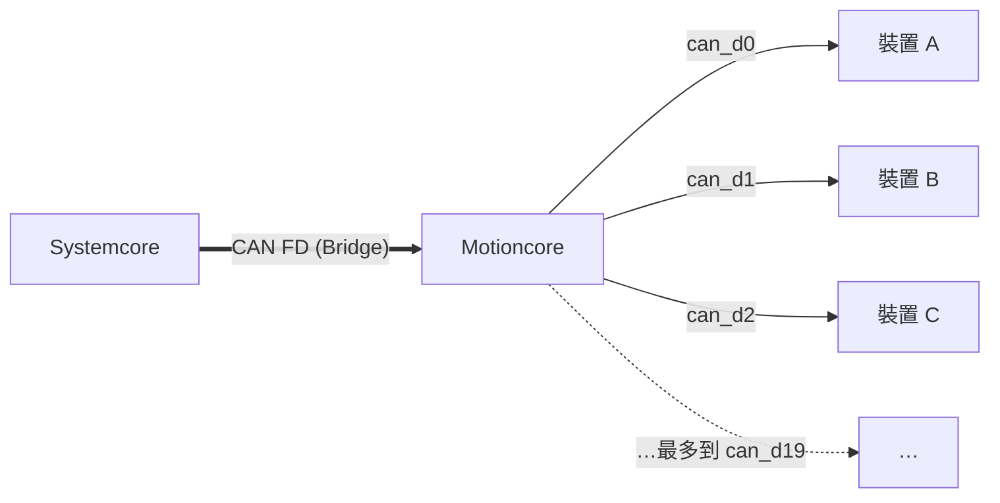

# 電源與 Motioncore

--8<-- "alpha-warning.md"

## 這頁學什麼

- 電從電池到馬達經過哪些元件
- 斷路器和保險絲為什麼重要
- Motioncore 是什麼、和 Systemcore 怎麼搭配

## 觀念

### 電從哪裡來

FRC 機器人的電全部來自一顆 **12V 鉛酸電池**。電池的電會依序經過：

1. **Main breaker（主斷路器）**：整台機器人的總開關，電流過大時會自動跳開。比賽時，機器人的電源就是用它來開關的。
2. **Power distribution（配電）**：把一路電分成很多路，每一路都有自己的 **Circuit breaker（斷路器）** 或保險絲，分別供電給各個元件。
3. **各個元件**：主控制器、馬達控制器、感測器等等。

!!! warning "注意：電流很大"
    FRC 機器人的馬達在卡住時，一顆就可能吃到上百安培的電流。斷路器是為了保護電線不會因為過熱而燒起來，**絕對不要用更大的斷路器取代原本的規格**。

### Motioncore

**Motioncore** 是 2027 新的 CAN 與電源分配裝置，和 Systemcore 搭配使用。目前公開的規格如下：

| 項目 | 規格 |
| --- | --- |
| Device port | 20 個，每個同時提供 CAN（1 Mbps）和電源 |
| 編碼器連接埠 | 3 個 quadrature（正交）編碼器埠，可用於里程計 |
| 和 Systemcore 的連線 | 透過 Bridge 連接埠，使用速度更快的 CAN FD |
| 保護 | 每組埠都有短路保護和硬體電流限制 |

Motioncore 最大的特色是 **點對點接線 (Point-to-point wiring)**：每個 Device port 接一個裝置，一條線同時包含電源和 CAN 訊號。這和傳統 CAN 把所有裝置串成一長串不同，某條線鬆脫時只會影響一個裝置。

在系統裡，Motioncore 的 20 個 Device port 各自是一條獨立的 CAN 匯流排，名稱是 `can_d0` 到 `can_d19`。

!!! info "尚未確認"
    2027 正式賽季的完整接線規則（例如還需不需要傳統的配電盤、哪些裝置一定要接在 Motioncore 上），要等 2027 賽季手冊 (Game Manual) 公布後才能確定。這頁會在規則公布後更新。

### 程式組需要知道什麼

程式不會直接控制電源，但以下幾點和程式組有關：

- **電壓會掉**：馬達同時全速運轉時，電池電壓可能掉到 7～8V 以下。電壓太低時控制器會進入保護模式，機器人會變得不穩定。這就是為什麼 [第 6 章](../06-motors-sensors/index.md) 要學 **Current limit（電流限制）**。
- **Motioncore 上的裝置位置**：程式要知道每個裝置接在哪一個 Device port，跟知道 CAN ID 一樣重要。

## 動手看看

- [ ] 在隊上的機器人找到電池、主斷路器、配電裝置
- [ ] 沿著一顆馬達的電源線往回追，找到它經過的斷路器
- [ ] 如果有 Motioncore，數一數用了幾個 Device port、各接了什麼

## 常見錯誤

!!! bug "常見錯誤：程式沒問題，其實是沒電"
    馬達不動時，新手很容易先懷疑程式。先檢查：電池有沒有充飽、主斷路器有沒有打開、斷路器有沒有跳掉、控制器的指示燈有沒有亮。

!!! bug "常見錯誤：把 Motioncore 的埠號和 Systemcore 的匯流排搞混"
    Motioncore 的 `can_d0` 和 Systemcore 的 `can_s0` 是不同的匯流排。程式裡指定裝置位置時，要分清楚是哪一邊。

## 小練習

1. 主斷路器和配電上的斷路器，保護的對象有什麼不同？
2. 比較「所有 CAN 裝置串成一條」和「Motioncore 點對點接線」，各有什麼優缺點？
