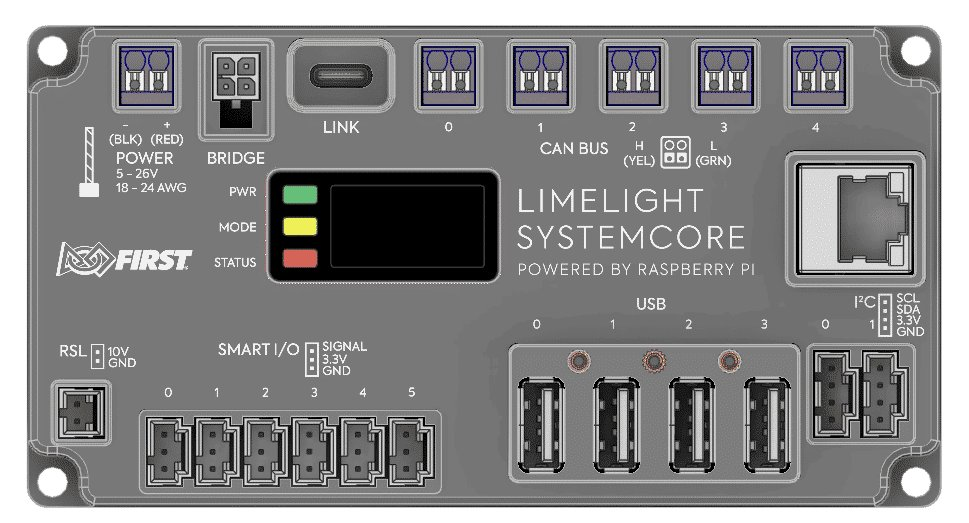
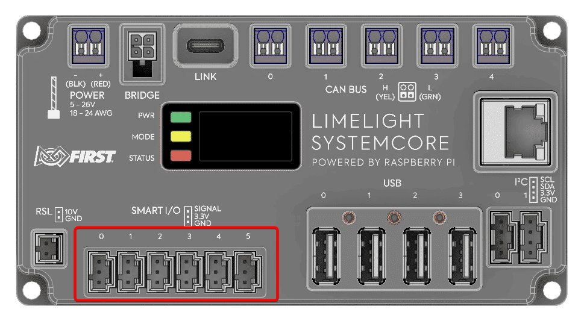

# Systemcore 主控制器

--8<-- "alpha-warning.md"

## 這頁學什麼

- Systemcore 在機器人上負責什麼
- Systemcore 上有哪些連接埠，各自接什麼
- 怎麼連上 Systemcore 的設定網頁

## 觀念

### 機器人的大腦

**Systemcore** 是 2027 年起 FRC 使用的主控制器 (Main controller)，由 FIRST 和 Limelight 合作開發。你寫的機器人程式會**部署 (Deploy)** 到 Systemcore 上執行。它負責三件事：

1. **接收指令**：從 Driver Station 收到手把的輸入和比賽狀態（現在是自動階段還是手動階段）
2. **執行你的程式**：根據輸入和感測器資料，決定每個馬達該做什麼
3. **送出指令**：透過 CAN 等連接埠，把命令送到馬達控制器

可以把 Systemcore 想成一台跑 Linux 的小電腦，加上一堆專門接機器人元件的連接埠。

<figure markdown="span">
  { loading=lazy }
  <figcaption>Systemcore 正面（示意圖）。中間的螢幕開機後會顯示 Wi-Fi 熱點的名稱、密碼和 IP 位址</figcaption>
</figure>

### 連接埠

根據目前公開的 alpha / beta 測試資料，Systemcore 的主要連接埠如下：

| 連接埠 | 數量 | 用途 |
| --- | --- | --- |
| CAN FD 匯流排 | 5 條 | 接馬達控制器、CAN 感測器、Motioncore |
| Smart IO | 6 個 | 可以用程式設定成數位輸入 / 輸出、PWM、類比輸入 |
| I2C | 2 個 | 接 I2C 感測器（例如顏色感測器） |
| USB | 有 | 接 USB 隨身碟（存 log）、相機等 |
| Ethernet | 有 | 接無線電、協同處理器 |
| 內建 IMU | 1 個 | 不用外接就能知道機器人的轉向 |

<figure markdown="span">
  { loading=lazy }
  <figcaption>上排：電源、Bridge、LINK（USB-C）、CAN BUS 0～4，右邊是 Ethernet。下排：RSL、Smart I/O 0～5（紅框）、USB 0～3、I2C 0～1</figcaption>
</figure>

**CAN (Controller Area Network，CAN 匯流排)** 是 FRC 最主要的通訊方式。一條 CAN 線可以串接很多裝置，每個裝置用一個 **CAN ID（CAN 編號）** 區分。2027 的 Systemcore 有 5 條 CAN 匯流排，系統裡的名稱是 `can_s0` 到 `can_s4`。

**Smart IO** 是 Systemcore 的新設計。roboRIO 上數位、類比、PWM 是分開的連接埠，Systemcore 改成同一組埠，由程式決定每個埠要當成哪一種。

!!! warning "注意：I2C 腳位和 roboRIO 不一樣"
    Systemcore 的 I2C 腳位順序和 roboRIO 相反（SCL 和 SDA 對調），跟 Qwiic 規格一致。直接拿舊的 roboRIO I2C 線來用，感測器會讀不到。

!!! info "2027 新改動：移除的功能"
    Systemcore 不支援 SPI、Relay、類比輸出等 roboRIO 上的功能。用 SPI 介面的舊陀螺儀（例如 ADXRS450）在 2027 不能用了，可以改用 Systemcore 內建的 IMU。

### 設定網頁

Systemcore 有內建的設定網頁，用來設定隊號、更新映像檔 (image)、安裝套件。連上 Systemcore 之後（USB、網路線，或 Systemcore 自己的 Wi-Fi 熱點），用瀏覽器打開：

```text
http://robot.local
```

Wi-Fi 熱點名稱和密碼會顯示在 Systemcore 的螢幕上。詳細的連線和設定步驟會在 [第 3 章 環境建置](../03-setup/index.md) 一步一步做。

## 動手看看

如果隊上已經有 Systemcore，找一台來對照上面的表格：

- [ ] 找到 5 個 CAN 連接埠，看看上面的標示
- [ ] 找到 Smart IO 連接埠
- [ ] 開機後看螢幕，找到 Wi-Fi 名稱和 IP 位址

## 常見錯誤

!!! bug "常見錯誤：裝置接錯 CAN 匯流排"
    5 條 CAN 匯流排是彼此獨立的。程式裡寫裝置在 CAN 0（`CANPort.CAN_S0`），實際卻接在 CAN 1，程式就找不到這個裝置。接線時要記錄**每個裝置接在哪一條匯流排、CAN ID 是多少**，這張表程式組一定會用到。

!!! bug "常見錯誤：用穩壓器供電"
    Systemcore 必須直接吃電池電壓，不能接在穩壓器 (Regulator) 後面，否則可能無法正常開機或運作。

## 小練習

1. 用自己的話解釋：為什麼一條 CAN 線上的每個裝置都需要不同的 CAN ID？
2. 隊上機器人有 8 顆馬達控制器、1 個 CANcoder。試著畫一張表，規劃它們要接在哪一條 CAN 匯流排、CAN ID 各是多少。

??? question "第 1 題參考答案"
    所有裝置共用同一條 CAN 線，Systemcore 送出的每個訊息都會傳到所有裝置。CAN ID 就像**地址**：訊息上寫著「給 ID 5 號的」，只有 5 號會照著做。如果兩個裝置的 ID 一樣，它們就分不清楚訊息是給誰的。

??? question "第 2 題參考答案"
    其中一種規劃方式：

    | 裝置 | 匯流排 | CAN ID |
    | --- | --- | --- |
    | 底盤馬達控制器 × 4 | `can_s0` | 1～4 |
    | 其他機構的馬達控制器 × 4 | `can_s1` | 10～13 |
    | CANcoder | `can_s1` | 40 |

    重點是：同一條匯流排上 ID 不重複，而且用機構分組，看到 ID 就知道是哪個機構。

??? question "想一想：為什麼要有 5 條 CAN 匯流排？"
    一條 CAN 匯流排的頻寬是有限的。裝置越多、每個裝置回傳資料越頻繁，匯流排就越容易塞車，資料延遲或遺失。把裝置分散到多條匯流排，每條的負擔就變輕。另外，某一條線斷掉時，只會影響那條線上的裝置，不會整台機器人一起停擺。
