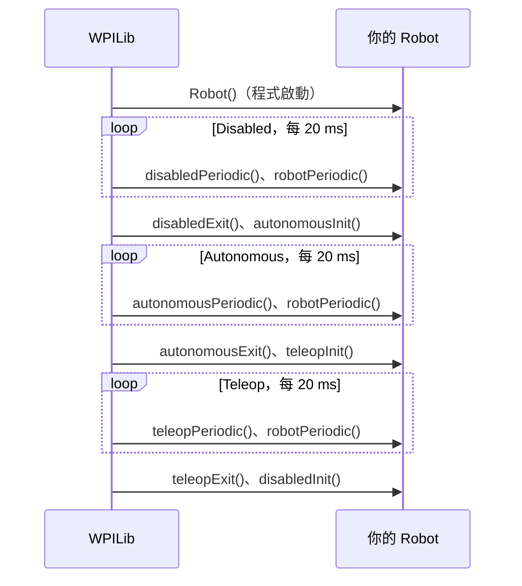

# 程式的生命週期

--8<-- "alpha-warning.md"

## 這頁學什麼

- 機器人的四種模式
- `TimedRobot` 會在什麼時候呼叫哪些方法
- 建構子、`Init`、`Periodic`、`Exit` 各自適合放什麼程式
- 為什麼 `Periodic` 裡不能寫會卡住的程式

## 觀念

### `Robot` 類別

打開 `Robot.java`，你會看到：

```java
public class Robot extends TimedRobot {
  // ...
}
```

`Robot` 繼承了 WPILib 的 **`TimedRobot`**（還記得 [繼承與介面](../01-java/inheritance.md) 嗎？）。`TimedRobot` 已經寫好了主迴圈：大約每 **20 ms**（每秒 50 次）呼叫一次你的方法。你要做的，就是覆寫這些方法，放進自己的程式。

### 機器人模式

| 模式 | 什麼時候 | 機器人會不會動 |
| --- | --- | --- |
| **Disabled**（停用） | 開機後、比賽開始前、比賽結束後 | 不會，所有馬達輸出都被關掉 |
| **Autonomous**（自動） | 比賽一開始的自動階段 | 會，依照程式自己動 |
| **Teleop**（手動） | 自動階段結束後，駕駛操控 | 會，依照手把輸入 |
| **Utility**（工具） | 測試、維修時，從 Driver Station 選擇 | 會 |

!!! info "2027 新改動"
    2026 以前的 **Test** 模式在 2027 改名為 **Utility**，對應的方法也從 `testInit()` 改成 `utilityInit()`。

### 每個模式的三個方法

每個模式都有三個方法可以覆寫：

| 方法 | 什麼時候被呼叫 | 適合放什麼 |
| --- | --- | --- |
| `xxxInit()` | **進入**這個模式時，呼叫一次 | 重設計時器、選擇自動程式 |
| `xxxPeriodic()` | 在這個模式中，**每 20 ms** 呼叫一次 | 讀感測器、讀手把、設定馬達 |
| `xxxExit()` | **離開**這個模式時，呼叫一次 | 收尾、停止機構 |

`xxx` 換成 `disabled`、`autonomous`、`teleop`、`utility`，例如 `teleopInit()`、`teleopPeriodic()`。

另外還有兩個特別的：

- **建構子 `Robot()`**：程式啟動時執行一次，用來建立馬達、感測器等物件
- **`robotPeriodic()`**：**不管在哪個模式**，每 20 ms 都會被呼叫，而且是在該模式的 `Periodic` 之後。適合放「一直都要做」的事，例如更新 Telemetry

!!! info "2027 新改動"
    2027 移除了 `robotInit()`。原本放在 `robotInit()` 的初始化程式，改放到 `Robot` 的建構子裡。

### 一場比賽的流程



### `Periodic` 不能卡住

每個 `Periodic` 方法都要**很快做完並 return**。WPILib 在同一個迴圈裡還要處理 Driver Station 的資料、更新安全機制。如果你的方法跑超過 20 ms，終端機會出現警告：

```text
Loop time of 0.02s overrun
```

更糟的是寫了無窮迴圈或 `Thread.sleep()`，整個程式都會卡住，**連 Disable 都可能失效**。

```java
@Override
public void autonomousPeriodic() {
  // ❌ 絕對不要這樣寫：程式會卡在這裡 2 秒
  motor.setThrottle(0.5);
  Thread.sleep(2000);
  motor.setThrottle(0);
}
```

想要「動 2 秒再停」，正確的做法是記錄開始時間，每次 `Periodic` 檢查時間到了沒（見下面的小練習），或是用第 5 章的 Command。

## 範例

把 `Robot.java` 改成下面這樣，部署後在 Driver Station 切換模式，觀察輸出的訊息（怎麼看輸出見 [部署與除錯](deploy-debug.md)）：

```java title="src/main/java/first/robot/Robot.java"
package first.robot;

import org.wpilib.framework.TimedRobot;

public class Robot extends TimedRobot {
  private int teleopLoops = 0;

  public Robot() {
    System.out.println("Robot 建構子：程式啟動");
  }

  @Override
  public void disabledInit() {
    System.out.println("進入 Disabled");
  }

  @Override
  public void autonomousInit() {
    System.out.println("進入 Autonomous");
  }

  @Override
  public void teleopInit() {
    System.out.println("進入 Teleop");
    teleopLoops = 0;
  }

  @Override
  public void teleopPeriodic() {
    teleopLoops++;
    if (teleopLoops % 50 == 0) {
      // 每 50 次迴圈（約 1 秒）印一次
      System.out.println("Teleop 已經執行約 " + (teleopLoops / 50) + " 秒");
    }
  }

  @Override
  public void teleopExit() {
    System.out.println("離開 Teleop，共執行了 " + teleopLoops + " 次迴圈");
  }
}
```

!!! tip "小技巧"
    機器人程式習慣用 `System.out.println()` 印出訊息，和第 1 章的 `IO.println()` 效果一樣。

## 常見錯誤

!!! bug "常見錯誤：在 `Periodic` 裡建立物件"
    ```java
    @Override
    public void teleopPeriodic() {
      SparkMax motor = new SparkMax(CANPort.CAN_S0, 10, MotorType.kBrushless); // ❌
      motor.setThrottle(0.5);
    }
    ```

    這會每 20 ms 建立一個新的馬達物件，很快就會出錯。馬達、感測器、手把這些物件，都要宣告成**欄位**，在宣告時或建構子裡建立**一次**。

!!! bug "常見錯誤：方法名稱拼錯，又沒加 `@Override`"
    寫成 `teleopPeriodc()`，WPILib 永遠不會呼叫它，看起來就像程式沒反應。每個覆寫的方法都要加 `@Override`。

!!! bug "常見錯誤：以為 `Init` 會一直執行"
    在 `teleopInit()` 裡讀手把、設定馬達，只會在進入 Teleop 的那一瞬間執行一次。要持續做的事放在 `Periodic`。

## 小練習

1. 執行上面的範例，依序切換 Disabled → Teleop → Disabled → Autonomous，寫下印出的訊息順序。
2. 在 `robotPeriodic()` 裡加上計數器，每 5 秒印一次「robotPeriodic 還在執行」。在不同模式下它都會印嗎？
3. 用計數的方式，讓 `autonomousPeriodic()` 在進入自動模式 2 秒後印出「2 秒到了」，而且只印一次。

??? question "第 1 題參考答案"
    ```text
    Robot 建構子：程式啟動         ← 程式啟動時，只有一次
    進入 Disabled
    進入 Teleop
    Teleop 已經執行約 1 秒        ← 每秒一次，持續到離開 Teleop
    Teleop 已經執行約 2 秒
    離開 Teleop，共執行了 ... 次迴圈
    進入 Disabled
    進入 Autonomous
    ```

    範例沒有覆寫 `disabledExit()` 和 `autonomousExit()`，所以離開 Disabled 和 Autonomous 時沒有訊息。

??? question "第 2 題參考答案"
    ```java
    private int robotLoops = 0;

    @Override
    public void robotPeriodic() {
      robotLoops++;
      if (robotLoops % 250 == 0) {   // 250 次 × 20 ms = 5 秒
        System.out.println("robotPeriodic 還在執行");
      }
    }
    ```

    **在所有模式下都會印**，包括 Disabled。`robotPeriodic()` 不管在哪個模式都會被呼叫。

??? question "第 3 題提示"
    在 `autonomousInit()` 把計數器歸零，在 `autonomousPeriodic()` 每次加 1。2 秒是 100 次迴圈。「只印一次」可以用 `==` 判斷，而不是 `>=`。

    WPILib 也有 `Timer` 類別可以計時，[第 9 章](../09-autonomous/timed.md) 會介紹。

??? question "第 3 題參考答案"
    ```java title="src/main/java/first/robot/Robot.java"
    package first.robot;

    import org.wpilib.framework.TimedRobot;

    public class Robot extends TimedRobot {
      private int autoLoops = 0;

      @Override
      public void autonomousInit() {
        autoLoops = 0;
      }

      @Override
      public void autonomousPeriodic() {
        autoLoops++;
        if (autoLoops == 100) {   // 100 次 × 20 ms = 2 秒，只有剛好等於 100 時印一次
          System.out.println("2 秒到了");
        }
      }
    }
    ```
