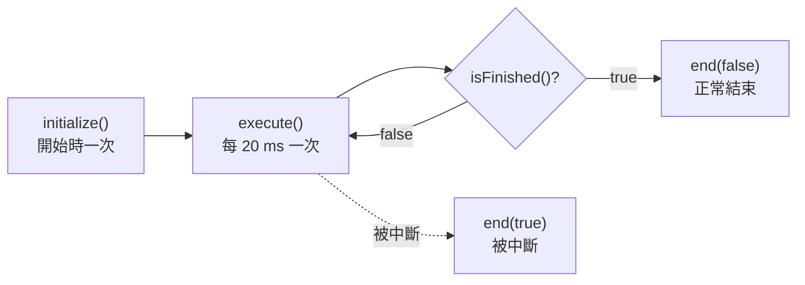

# Command

--8<-- "alpha-warning.md"

## 這頁學什麼

- Command 的生命週期：`initialize`、`execute`、`isFinished`、`end`
- 用 Command factory 快速建立 Command
- 自己寫一個 Command 類別
- Command 被中斷時會發生什麼事

## 觀念

### Command 的生命週期

每個 Command 從開始到結束，會經過四個階段：



| 方法 | 什麼時候被呼叫 | 適合放什麼 |
| --- | --- | --- |
| `initialize()` | Command 開始時，一次 | 設定馬達輸出、重設計時 |
| `execute()` | 執行中，每 20 ms 一次 | 根據最新的輸入調整輸出 |
| `isFinished()` | 每次 `execute()` 之後 | 回傳 `true` 時 Command 結束 |
| `end(boolean interrupted)` | 結束時，一次 | 停止馬達、收尾 |

`end()` 的參數 `interrupted` 告訴你是**正常結束**（`isFinished()` 回傳 `true`）還是**被中斷**（被其他 Command 搶走 Subsystem、按鈕放開、機器人被停用等）。不管是哪一種，`end()` 都會被呼叫，所以**停止馬達的程式一定要放在 `end()`**。

### Command factory

大部分的 Command 都不用自己寫類別，用 Subsystem 內建的 factory 方法就能建立。這些方法會**自動把這個 Subsystem 加為 Requirement**：

| 方法 | 開始時 | 執行中 | 結束時 | 會自己結束嗎 |
| --- | --- | --- | --- | --- |
| `runOnce(action)` | 執行 `action` | — | — | 會，立刻結束 |
| `run(action)` | — | 每次執行 `action` | — | 不會 |
| `startEnd(start, end)` | 執行 `start` | — | 執行 `end` | 不會 |
| `runEnd(run, end)` | — | 每次執行 `run` | 執行 `end` | 不會 |

參數都是 [`Runnable`](../01-java/lambda.md#lambda-的型別functional-interface)，也就是 Lambda 或 method reference：

```java
// 在 Intake 類別裡
public Command intakeCommand() {
  return startEnd(
      () -> setThrottle(0.8),   // 開始時：馬達轉
      this::stop);              // 結束時：馬達停
}
```

「不會自己結束」的 Command，要靠外部讓它結束：按鈕放開、被其他 Command 中斷，或是加上 `.until()`、`.withTimeout()` 這類**修飾 (Decorator)**：

```java
startEnd(() -> setThrottle(0.8), this::stop)
    .until(this::hasGamePiece)     // 拿到物件時結束
    .withName("Intake");           // 取個名字，除錯時比較好認
```

`withTimeout(秒數)` 則是時間到就結束。下一頁會再介紹更多修飾和組合方式。

不屬於任何 Subsystem 的 Command，可以用 `Commands` 類別的靜態方法建立：

```java
Commands.print("Hello");          // 印出訊息
Commands.waitSeconds(1.0);        // 等 1 秒
Commands.runOnce(() -> ..., intake);  // 最後的參數是 Requirements
```

### 自己寫 Command 類別

邏輯比較複雜、需要自己的狀態時，可以寫一個繼承 `Command` 的類別，放在 `commands/` 資料夾。下面這個類別和上面的 `intakeCommand()` 做的事完全一樣：

```java title="src/main/java/first/robot/commands/IntakeUntilLoaded.java"
package first.robot.commands;

import first.robot.Constants.IntakeConstants;
import first.robot.subsystems.Intake;
import org.wpilib.command2.Command;

public class IntakeUntilLoaded extends Command {
  private final Intake intake;

  public IntakeUntilLoaded(Intake intake) {
    this.intake = intake;
    addRequirements(intake);
  }

  @Override
  public void initialize() {
    intake.setThrottle(IntakeConstants.INTAKE_THROTTLE);
  }

  @Override
  public boolean isFinished() {
    return intake.hasGamePiece();
  }

  @Override
  public void end(boolean interrupted) {
    intake.stop();
  }
}
```

使用時：`new IntakeUntilLoaded(intake)`。

**什麼時候用哪一種？**

- **Factory**：大部分情況。程式短、放在 Subsystem 裡，一眼就看得到這個機構能做什麼
- **自訂類別**：需要自己的欄位（例如計時、計數）、`execute()` 的邏輯很長，或是需要用到好幾個 Subsystem

### 啟動 Command

Command 建立之後**不會自己執行**，要交給 Scheduler。通常是透過 [Trigger](triggers.md) 綁定按鍵，或是在自動模式開始時啟動：

```java
CommandScheduler.getInstance().schedule(command);
```

!!! info "2027 新改動"
    2026 以前可以直接寫 `command.schedule()`。2027 移除了這個方法，改用 `CommandScheduler.getInstance().schedule(command)`。

## 常見錯誤

!!! bug "常見錯誤：只在 `isFinished()` 結束時才停馬達"
    把停止馬達寫在 `execute()` 裡判斷「快結束了就停」，而不是寫在 `end()`。Command 被中斷時不會走到那段程式，馬達就會一直轉。**收尾一律寫在 `end()`。**

!!! bug "常見錯誤：自訂 Command 忘了 `addRequirements()`"
    沒有宣告 Requirements，Scheduler 不知道這個 Command 在用 Intake，兩個 Command 就可能同時控制同一顆馬達。

!!! bug "常見錯誤：把馬達動作寫成 `runOnce`"
    ```java
    runOnce(() -> setThrottle(0.8))   // ❌ 立刻結束，但馬達會一直轉下去
    ```

    `runOnce` 執行完就結束了，沒有 `end` 可以停馬達。馬達會一直轉，直到其他 Command 改變它的輸出。要「執行期間轉、結束時停」，用 `startEnd`。

## 小練習

1. 在 `Intake` 裡加一個 `slowIntakeCommand()`：用 0.3 的速度吸入，拿到物件時停止。
2. 用 `runEnd` 寫一個 Command：執行期間每 20 ms 都把 `-gamepad.getLeftY()` 設給 Intake 馬達，結束時停止。（提示：Subsystem 的方法要接收一個 `DoubleSupplier` 參數）
3. 寫一個自訂 Command 類別 `EjectForTime`：吐出 1 秒後自動結束。（提示：用計數器，或在 `initialize()` 記下開始時間）

??? question "第 1 題參考答案"
    ```java
    public Command slowIntakeCommand() {
      return startEnd(() -> setThrottle(0.3), this::stop)
          .until(this::hasGamePiece)
          .withName("SlowIntake");
    }
    ```

    和 `intakeCommand()` 一樣，只是速度不同。如果有很多種速度，可以改成接收一個速度參數的 `intakeCommand(double throttle)`。

??? question "第 2 題參考答案"
    ```java
    public Command manualCommand(DoubleSupplier throttle) {
      return runEnd(() -> setThrottle(throttle.getAsDouble()), this::stop);
    }
    ```

    使用時：`intake.manualCommand(() -> -driver.getLeftY())`。這就是 [Lambda](../01-java/lambda.md#常見錯誤) 那頁「傳值和傳取得值的方法」的差別：要傳 Lambda，Command 每次執行才會讀到最新的搖桿值。

??? question "第 3 題參考答案"
    ```java title="src/main/java/first/robot/commands/EjectForTime.java"
    package first.robot.commands;

    import first.robot.Constants.IntakeConstants;
    import first.robot.subsystems.Intake;
    import org.wpilib.command2.Command;
    import org.wpilib.system.Timer;

    public class EjectForTime extends Command {
      private final Intake intake;
      private final Timer timer = new Timer();

      public EjectForTime(Intake intake) {
        this.intake = intake;
        addRequirements(intake);
      }

      @Override
      public void initialize() {
        timer.restart();
        intake.setThrottle(IntakeConstants.EJECT_THROTTLE);
      }

      @Override
      public boolean isFinished() {
        return timer.hasElapsed(1.0);
      }

      @Override
      public void end(boolean interrupted) {
        intake.stop();
      }
    }
    ```

    WPILib 的 `Timer` 用 `restart()` 歸零並開始計時，`hasElapsed(秒數)` 判斷時間到了沒。

    同樣的事情用 factory 只要一行：`intake.ejectCommand().withTimeout(1.0)`。
