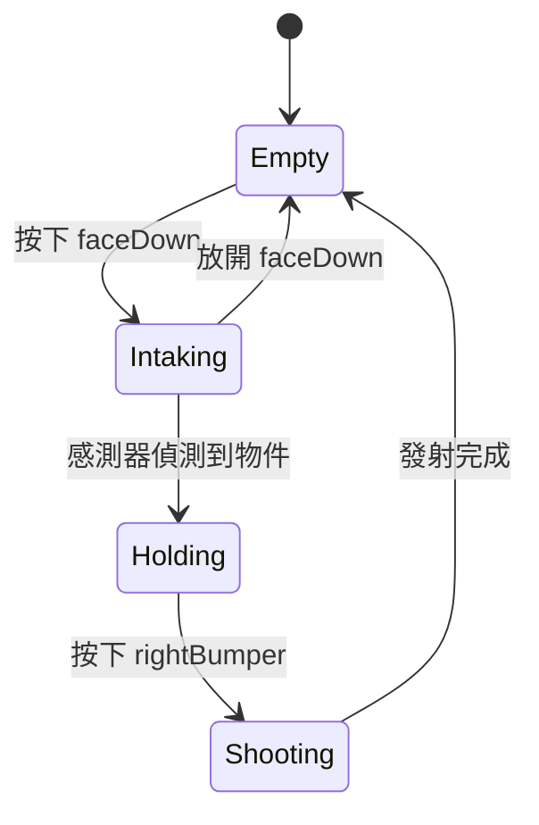

# 延伸學習

這一節的內容不是必讀，第一次讀可以先跳過。

## Commands v3

WPILib 2027 新增了 **Commands v3**。它的觀念和 v2 很像，但寫 Command 的方式完全不同：用 **Coroutine（協程）**，像寫一般的程式一樣，由上往下寫出整個動作。

### 用 v3 寫「吸入直到拿到物件」

```java
public class Intake implements Mechanism {
  // 馬達、感測器的宣告和 v2 一樣

  public Command intakeCommand() {
    return run(coroutine -> {
          motor.setThrottle(0.8);
          coroutine.waitUntil(this::hasGamePiece);   // 在這裡「暫停」，直到拿到物件
          motor.stopMotor();
        })
        .whenCanceled(motor::stopMotor)
        .named("Intake");
  }
}
```

和 v2 比較：

```java
// v2
public Command intakeCommand() {
  return startEnd(() -> motor.setThrottle(0.8), motor::stopMotor)
      .until(this::hasGamePiece)
      .withName("Intake");
}
```

v3 的 `coroutine.waitUntil()` 看起來像是「卡住等待」，但它其實會把控制權交還給 Scheduler，下一次迴圈再從這裡繼續。所以不會像 [第 4 章](../04-robot-basics/lifecycle.md#periodic-不能卡住) 講的 `Thread.sleep()` 那樣卡住整個程式。

### v2 和 v3 對照

| | Commands v2 | Commands v3 |
| --- | --- | --- |
| 機構 | `Subsystem`（繼承 `SubsystemBase`） | `Mechanism`（介面，`implements Mechanism`） |
| 寫一個動作 | `initialize` / `execute` / `isFinished` / `end`，或 factory + 修飾 | 一個 Coroutine，由上往下寫 |
| 等待 | `.until(...)`、`Commands.waitSeconds(...)` | `coroutine.waitUntil(...)`、`coroutine.wait(...)` |
| 命名 | `.withName(...)`，選填 | `.named(...)`，**必填** |
| 衝突處理 | 新的 Command 中斷舊的 | 可以設定優先順序 (`withPriority`) |
| 機器人架構 | 通常搭配 `TimedRobot` | 範本使用 2027 新的 OpMode 架構 |
| vendordep | `CommandsV2.json` | `CommandsV3.json`（不能和 v2 同時使用） |

### 什麼時候考慮換到 v3

- v3 的官方文件完成、社群範例變多之後
- 有很多「先做 A，等某個條件，再做 B」這種長流程的動作時，v3 的寫法會比較直覺
- 想試的話，可以用 **Command v3 Robot** 範本建立一個新專案，讀讀看裡面的範例和註解

## State machine（狀態機）

比較複雜的機構，常常會用 **State machine（狀態機）** 的方式思考：機構在任何時候都處於某一個**狀態**，特定的事件發生時，會**轉換**到另一個狀態。



在 Command-based 裡，每個狀態可以對應到一個 Command，狀態之間的轉換就是 Trigger。這一章寫的 Intake 和 Shooter，其實就是上面這個狀態機。先畫出狀態圖再寫程式，可以幫你發現漏掉的情況，例如「Holding 狀態下又按了 faceDown 要怎麼辦？」。

WPILib 2027 的 Commands v3 也提供了宣告式的狀態機 API (`StateMachine`)，有興趣可以查看 v3 的 API 文件。

## 進一步閱讀

- [WPILib 文件：Command-Based Programming](https://docs.wpilib.org/en/latest/docs/software/commandbased/index.html)：官方的 Command-based 說明（部分內容可能還是 2026 的寫法，注意 package 名稱）
- 其他隊伍公開的程式碼：很多強隊的 GitHub 上有整個賽季的 Command-based 程式，可以看看他們怎麼拆 Subsystem、怎麼組合 Command
