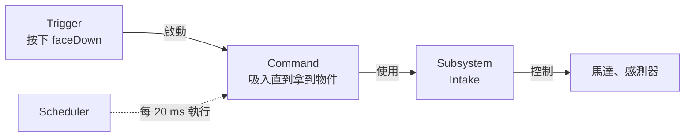

# 第 5 章 Command-based 架構

--8<-- "alpha-warning.md"

第 4 章把所有程式都寫在 `Robot.java` 裡。機器人只有一顆馬達時還好，但真正的比賽機器人有底盤、Intake、手臂、發射器……全部塞在一個檔案裡，很快就會亂成一團。**Command-based** 是 WPILib 提供的程式架構，幫你把程式整理得清楚、好維護，也是大部分 FRC 隊伍使用的架構。

## 這章學什麼

- Command-based 的四個核心觀念：Subsystem、Command、Trigger、Scheduler
- 把一個機構寫成 Subsystem
- 用 Command factory 和自訂類別建立 Command
- 把手把按鍵、感測器綁定到 Command
- 把好幾個 Command 組合成一連串的動作
- `Robot`、`RobotContainer`、`Constants` 怎麼分工

**需要先讀**：[第 1 章的 Lambda](../01-java/lambda.md)（這章非常多）、[第 4 章 機器人程式基礎](../04-robot-basics/index.md)

## 四個核心觀念

| 觀念 | 是什麼 | 例子 |
| --- | --- | --- |
| **Subsystem（子系統）** | 機器人上的一個機構，管理自己的馬達和感測器 | `Intake`、`Shooter`、`Drivetrain` |
| **Command（指令）** | 一個動作，會使用一個或多個 Subsystem | 「吸入直到拿到物件」、「發射」 |
| **Trigger（觸發條件）** | 決定什麼時候執行 Command | 按下按鈕、感測器偵測到物件 |
| **Scheduler（排程器）** | 每 20 ms 檢查 Trigger、執行 Command | WPILib 提供，不用自己寫 |

## 這章的專案

這章使用 [第 3 章](../03-setup/first-project.md) 用 **Command v2 Robot** 範本建立的專案。範例以一台簡單的機器人為例：

- **Intake**：一顆馬達 + 一個光遮斷感測器，用來吸入遊戲物件
- **Shooter**：一顆馬達，用來把遊戲物件發射出去

這章寫完的程式會是後面幾章的基礎。

## Commands v2 和 v3

WPILib 2027 有兩代 Command-based 框架：

- **Commands v2**：從 2020 年用到現在，資源和範例最多。**本教學使用 v2**
- **Commands v3**：2027 新增，用 Coroutine（協程）的方式寫 Command，目前文件還在撰寫中

兩者的觀念相通，學會 v2 之後要換到 v3 並不難。[延伸學習](further.md) 會介紹 v3 的寫法。

!!! info "2027 新改動：Commands v2"
    用過 2026 以前 Command-based 的人，注意這些改動：

    - package 從 `edu.wpi.first.wpilibj2.command` 改成 **`org.wpilib.command2`**
    - Commands v2 變成一個 vendordep（`CommandsV2.json`），用範本建立專案時會自動加入
    - **`command.schedule()` 移除了**，改用 `CommandScheduler.getInstance().schedule(command)`
    - 手把可以用新的 **`CommandGamepad`**，按鈕用位置命名（`faceDown()` 等）
    - 新增 `Subsystem.idle()`：一個什麼都不做、但會佔用 Subsystem 的 Command

## 本章內容

| 小節 | 內容 |
| --- | --- |
| [為什麼要用 Command-based](why.md) | Command-based 解決了什麼問題、Scheduler 怎麼運作 |
| [Subsystem](subsystem.md) | 把一個機構寫成 Subsystem |
| [Command](commands.md) | Command 的生命週期、factory、自訂 Command 類別 |
| [Trigger 與按鍵綁定](triggers.md) | 把按鍵、感測器綁定到 Command |
| [組合 Command](composition.md) | 依序、同時、競速執行好幾個 Command |
| [RobotContainer](robot-container.md) | 把所有東西組裝起來 |
| [延伸學習](further.md) | Commands v3、狀態機 |
