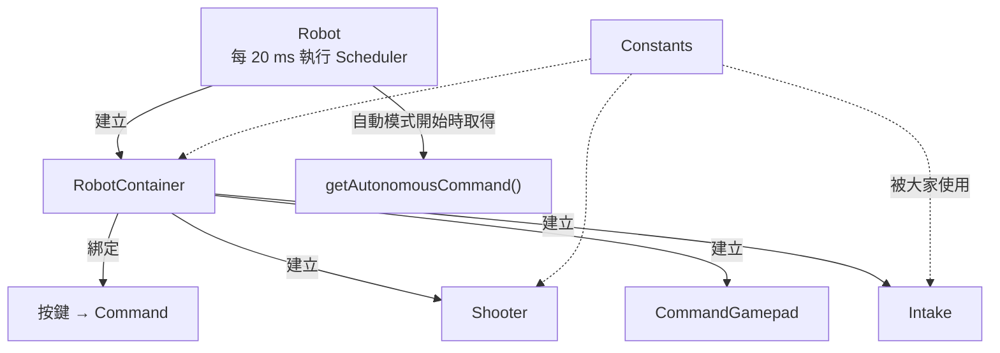

# RobotContainer

--8<-- "alpha-warning.md"

## 這頁學什麼

- `Robot`、`RobotContainer`、`Constants` 三個檔案怎麼分工
- 在 `RobotContainer` 裡建立 Subsystem、設定 default command、綁定按鍵
- 提供自動模式要執行的 Command
- 用 `Constants` 管理常數

## 觀念

### 三個檔案的分工

| 檔案 | 負責 | 多久改一次 |
| --- | --- | --- |
| `Robot.java` | 執行 Scheduler、在模式切換時啟動 / 取消自動程式 | 幾乎不改 |
| `RobotContainer.java` | 建立所有 Subsystem 和手把、設定 default command、綁定按鍵、選擇自動程式 | 常常改 |
| `Constants.java` | 所有的常數：CAN ID、速度、時間、手把編號 | 常常改 |



### `Robot.java`：通常不用改

範本產生的 `Robot.java` 已經寫好了 Command-based 需要的所有東西：

- 建構子建立 `RobotContainer`
- `robotPeriodic()` 執行 `CommandScheduler.getInstance().run()`
- `autonomousInit()` 從 `RobotContainer` 取得自動程式並啟動，`autonomousExit()` 取消它
- `utilityInit()` 取消所有 Command

所以在 Command-based 專案裡，**你幾乎不會改 `Robot.java`**，程式都寫在 `RobotContainer` 和各個 Subsystem、Command 裡。

### Constants

把所有「數字」集中放在 `Constants.java`，好處是：

- 要調整速度、時間，只需要打開一個檔案
- 不會在程式裡到處出現看不懂的數字（例如 `0.8`、`1.5`）
- CAN ID 集中管理，比較不會重複

用 `static final` 宣告，再依機構分成好幾個內部類別：

```java title="src/main/java/first/robot/Constants.java"
package first.robot;

public final class Constants {
  public static final class OperatorConstants {
    public static final int DRIVER_CONTROLLER_PORT = 0;
  }

  public static final class IntakeConstants {
    public static final int MOTOR_ID = 10;
    public static final int BEAM_BREAK_CHANNEL = 0;
    public static final double INTAKE_THROTTLE = 0.8;
    public static final double EJECT_THROTTLE = -0.5;
  }

  public static final class ShooterConstants {
    public static final int MOTOR_ID = 20;
    public static final double SHOOT_THROTTLE = 0.9;
    public static final double SPIN_UP_SECONDS = 1.0;
    public static final double FEED_SECONDS = 0.5;
  }

  private Constants() {}
}
```

使用時：`IntakeConstants.MOTOR_ID`。檔案開頭要 `import first.robot.Constants.IntakeConstants;`。

## 範例

把這一章寫的東西全部組裝起來：

```java title="src/main/java/first/robot/RobotContainer.java"
package first.robot;

import first.robot.Constants.OperatorConstants;
import first.robot.commands.ScoringCommands;
import first.robot.subsystems.Intake;
import first.robot.subsystems.Shooter;
import org.wpilib.command2.Command;
import org.wpilib.command2.Commands;
import org.wpilib.command2.button.CommandGamepad;
import org.wpilib.command2.button.Trigger;

public class RobotContainer {
  // Subsystem：每個只建立一次
  private final Intake intake = new Intake();
  private final Shooter shooter = new Shooter();

  // 手把
  private final CommandGamepad driver = new CommandGamepad(OperatorConstants.DRIVER_CONTROLLER_PORT);

  public RobotContainer() {
    configureDefaultCommands();
    configureBindings();
  }

  private void configureDefaultCommands() {
    intake.setDefaultCommand(intake.stopCommand());
  }

  private void configureBindings() {
    // 按住吸入、按住吐出
    driver.faceDown().whileTrue(intake.intakeCommand());
    driver.faceRight().whileTrue(intake.ejectCommand());

    // 有遊戲物件時，按一下右肩鍵發射
    driver.rightBumper()
        .and(intake::hasGamePiece)
        .onTrue(ScoringCommands.shoot(intake, shooter));

    // 拿到遊戲物件時印出訊息
    new Trigger(intake::hasGamePiece).onTrue(Commands.print("拿到遊戲物件！"));
  }

  /** 自動模式：先發射預載的遊戲物件，再吸入 3 秒。 */
  public Command getAutonomousCommand() {
    return ScoringCommands.shoot(intake, shooter)
        .andThen(intake.intakeCommand().withTimeout(3.0))
        .withName("ShootThenIntake");
  }
}
```

這時候專案的結構：

```text
src/main/java/first/robot/
├── Robot.java              ← 範本原本的，不用改
├── RobotContainer.java     ← 這頁的範例
├── Constants.java          ← 這頁的範例
├── commands/
│   └── ScoringCommands.java
└── subsystems/
    ├── Intake.java
    └── Shooter.java
```

範本附的 `ExampleSubsystem.java`、`ExampleCommand.java`、`Autos.java` 用不到了，可以刪掉。

!!! tip "小技巧：自動程式的選擇"
    這裡的 `getAutonomousCommand()` 永遠回傳同一個自動程式。比賽時通常需要在 Dashboard 上選擇要執行哪一個，[第 9 章](../09-autonomous/index.md) 會介紹 2027 的 `Selectable`。

## 常見錯誤

!!! bug "常見錯誤：Subsystem 宣告了，但從沒建立"
    ```java
    private Intake intake;   // ❌ 沒有 new，是 null
    ```

    之後在 `configureBindings()` 呼叫 `intake.intakeCommand()` 就會 `NullPointerException`。宣告時就直接 `new`，並加上 `final`。

!!! bug "常見錯誤：欄位的建立順序"
    Java 的欄位是**由上往下**建立的。如果某個欄位的建立需要用到另一個欄位（例如把 `intake` 傳給某個物件），被用到的那個要寫在**上面**。

!!! bug "常見錯誤：刪掉範本檔案後編譯失敗"
    刪掉 `Autos.java` 之前，先確認 `RobotContainer` 已經不再使用它，否則會出現 `cannot find symbol` 的錯誤。

## 小練習

1. 把這一章的 `Constants`、`Intake`、`Shooter`、`ScoringCommands`、`RobotContainer` 都放進你的專案，編譯並部署。
2. 把 `faceLeft` 綁定為「吸入然後發射」（上一頁小練習 1 寫的 `intakeThenShoot`）。
3. 在 Elastic 上找到 `Intake/HasGamePiece`，用手遮住光遮斷感測器，看數值的變化。
4. 試試看：發射的時候按住 `faceDown`，會發生什麼事？用「Requirements」解釋。

??? question "第 4 題參考答案"
    發射會被中斷，改成執行吸入。因為發射和吸入都需要 Intake，新啟動的吸入 Command 會中斷正在使用 Intake 的發射 Command。發射被中斷時，Shooter 的 `spinCommand()` 也跟著結束，馬達停止。
