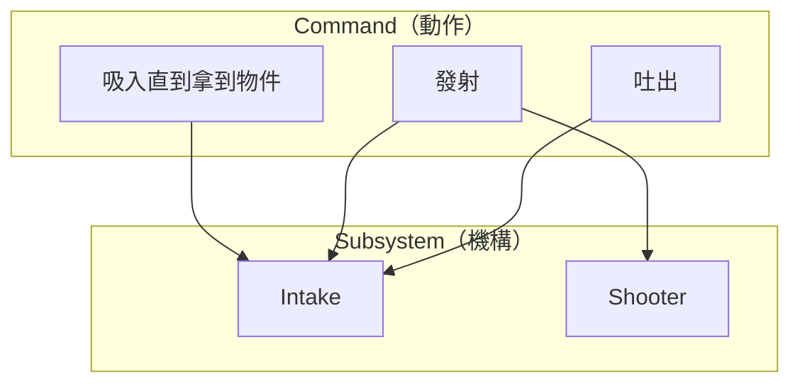
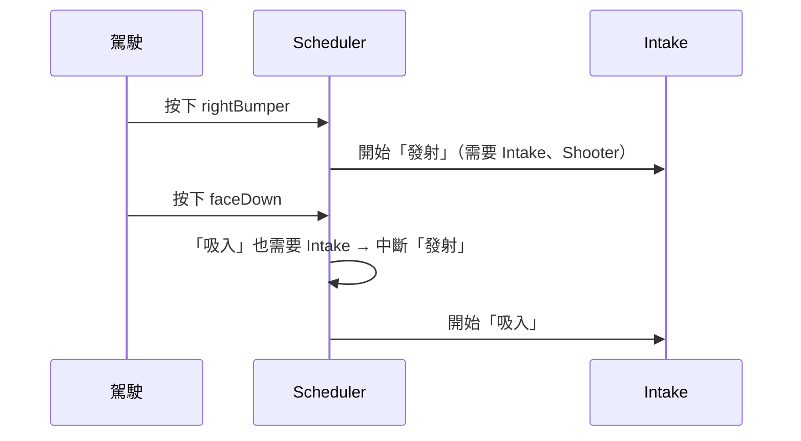

# 為什麼要用 Command-based

--8<-- "alpha-warning.md"

## 這頁學什麼

- 全部寫在 `Robot.java` 會遇到什麼問題
- 「機構」和「動作」分開的好處
- Scheduler 每 20 ms 在做什麼
- Requirements（需求）怎麼避免兩個動作搶同一個機構

## 觀念

### 全部寫在 `Robot.java` 的問題

假設機器人有 Intake 和 Shooter，要做到：

- 按住 `faceDown`：Intake 吸入，拿到物件就自動停止
- 按一下 `rightBumper`：Shooter 先轉 1 秒，再讓 Intake 把物件送進去，0.5 秒後全部停止

用第 4 章的寫法，`teleopPeriodic()` 大概會變成這樣：

```java
@Override
public void teleopPeriodic() {
  if (gamepad.getRightBumperButtonPressed()) {
    shooting = true;
    shootLoops = 0;
  }

  if (shooting) {
    shootLoops++;
    shooterMotor.setThrottle(0.9);
    if (shootLoops > 50) {
      intakeMotor.setThrottle(0.8);     // 轉了 1 秒之後才送
    }
    if (shootLoops > 75) {
      shooting = false;
      shooterMotor.stopMotor();
      intakeMotor.stopMotor();
    }
  } else if (gamepad.getFaceDownButton() && beamBreak.get()) {
    intakeMotor.setThrottle(0.8);
  } else {
    intakeMotor.stopMotor();
  }
}
```

才兩個動作就已經很難讀了，而且有很多問題：

- **狀態到處都是**：`shooting`、`shootLoops` 這些變數只是為了記住「發射做到哪一步」
- **很難重複使用**：自動階段也要發射的話，這段邏輯得再寫一次
- **很容易衝突**：發射時如果按了 `faceDown`，兩段程式都想控制 Intake 馬達，誰說了算？
- **很難分工**：所有人都在改同一個方法

### 把「機構」和「動作」分開

Command-based 把程式拆成兩種東西：

- **Subsystem（子系統）**：**機構本身**。Intake 有一顆馬達和一個感測器，它知道怎麼讓馬達轉、怎麼判斷有沒有物件，但**不知道**什麼時候該做這些事
- **Command（指令）**：**一個動作**。「發射」這個動作知道要先讓 Shooter 轉、再讓 Intake 送，但**不用知道**馬達接在哪條 CAN 匯流排



這樣的好處：

- 每個 Subsystem 是一個檔案，每個人負責一個機構
- 同一個 Command 可以綁在按鈕上，也可以放在自動程式裡
- 改了 Intake 的馬達型號，只要改 `Intake` 這一個類別

### Scheduler 在做什麼

**CommandScheduler（排程器）** 是 Command-based 的核心。範本的 `Robot.java` 裡有這一行：

```java
@Override
public void robotPeriodic() {
  CommandScheduler.getInstance().run();
}
```

每 20 ms，`run()` 會依序做這些事：

1. 呼叫每個 Subsystem 的 `periodic()`
2. 檢查所有 Trigger，條件成立的就啟動對應的 Command
3. 執行每個正在執行的 Command 一次，結束的就移除
4. 沒有 Command 在用的 Subsystem，啟動它的 **Default command（預設指令）**

你只要定義好 Subsystem、Command、Trigger，剩下的交給 Scheduler。

### Requirements：一個機構同時只能做一件事

每個 Command 都要宣告它會用到哪些 Subsystem，這叫 **Requirements（需求）**。Scheduler 保證：**同一個 Subsystem 同時只會有一個 Command 在使用它**。

上面的衝突問題就這樣解決了：發射的 Command 需要 Intake 和 Shooter。發射時按下 `faceDown`，「吸入」的 Command 也需要 Intake，Scheduler 會**中斷 (Interrupt)** 正在用 Intake 的發射 Command，改執行吸入。



新的 Command 會中斷舊的，這是預設行為。這讓駕駛永遠能用最新的操作接手機器人。

## 常見錯誤

!!! bug "常見錯誤：刪掉了 `CommandScheduler.getInstance().run()`"
    整理 `Robot.java` 時不小心刪掉這一行，**所有的 Command 都不會執行**，按什麼按鈕都沒反應，也不會有錯誤訊息。

!!! bug "常見錯誤：繞過 Subsystem 直接控制馬達"
    在 Command 裡直接拿 Subsystem 的馬達物件來設定，或在 `Robot.java` 裡另外 `new` 一顆同樣 CAN ID 的馬達，Scheduler 的 Requirements 就保護不了你。馬達一律只由它所屬的 Subsystem 控制。

## 小練習

1. 想想你們隊上的機器人（或去年的機器人），列出它有哪些 Subsystem。
2. 為每個 Subsystem 列出 2～3 個 Command，並寫下每個 Command 需要哪些 Subsystem。
3. 有沒有哪個 Command 同時需要兩個以上的 Subsystem？它跟其他 Command 可能會有什麼衝突？
