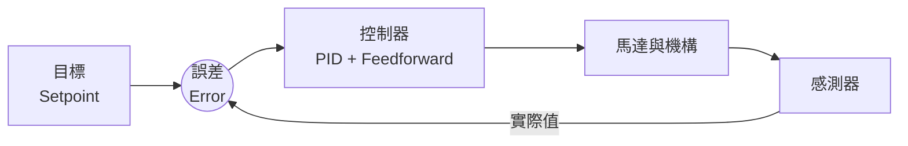

# 第 8 章 控制入門

--8<-- "alpha-warning.md"

到目前為止，我們都是用 `setThrottle(0.8)` 這種方式控制馬達：給一個固定的輸出，馬達轉多快、轉到哪裡，全看運氣（和電池電量）。這章要讓機構**自己修正**：Shooter 維持在指定轉速、手臂轉到指定角度並停在那裡、機器人轉到指定方向。

## 這章學什麼

- Open loop（開迴路）和 Closed loop（閉迴路）的差別
- PID 控制：P、I、D 各自在做什麼，怎麼調
- Feedforward：用物理模型預測需要多少電壓
- Motion Profile：讓機構平順地加速、減速
- SysId：量測機構的特性，算出 Feedforward 的參數

**需要先讀**：[第 6 章 馬達與感測器](../06-motors-sensors/index.md)，特別是[編碼器](../06-motors-sensors/encoders.md)

## Open loop 和 Closed loop

| | Open loop（開迴路） | Closed loop（閉迴路） |
| --- | --- | --- |
| 做法 | 給一個固定的輸出 | 一直量測實際結果，根據誤差調整輸出 |
| 例子 | `setThrottle(0.8)` | 「維持 4000 RPM」、「轉到 45 度」 |
| 電池電量變化時 | 結果跟著變 | 會自動補償 |
| 需要感測器 | 不用 | 要（編碼器、IMU 等） |

Closed loop 的核心是**誤差 (Error) = 目標 - 實際值**。控制器的工作就是根據誤差算出輸出，讓誤差越來越小。

## 在哪裡算：Systemcore 還是馬達控制器

控制的計算可以在兩個地方做：

| | 在 Systemcore 上（WPILib） | 在馬達控制器上（REV / CTRE） |
| --- | --- | --- |
| 更新頻率 | 每 20 ms | 每 1 ms 或更快 |
| 感測器 | 任何感測器（例如 IMU） | 接在控制器上的感測器 |
| 寫法 | `PIDController` 等 WPILib 類別 | 設定控制器參數，送出目標值 |
| 適合 | 底盤轉向（用 IMU）、需要多個感測器的控制 | 單一馬達的速度、位置控制 |

能在馬達控制器上做的，**盡量在控制器上做**：更新得快、不佔用 Systemcore 的運算、也不受 CAN 延遲影響。這章兩種都會介紹。

## 這章的範例

| 頁面 | 範例 | 在哪裡算 |
| --- | --- | --- |
| [PID](pid.md) | 底盤轉到指定角度（用 IMU） | Systemcore |
| [Feedforward](feedforward.md) | Shooter 維持指定轉速 | 馬達控制器 |
| [Motion Profile](motion-profile.md) | 手臂平順地轉到指定角度 | 馬達控制器 |
| [SysId](sysid.md) | 量測 Shooter 的 Feedforward 參數 | — |

!!! warning "注意：調參數時一定要小心"
    調 PID 時，參數設錯可能讓機構**劇烈震盪**或**全速衝出去**。每次調整：

    - 從很小的值開始，一次只改一個參數
    - 手放在 Disable 的位置
    - 機構周圍不要有人，手臂、升降機構要有硬體擋塊
