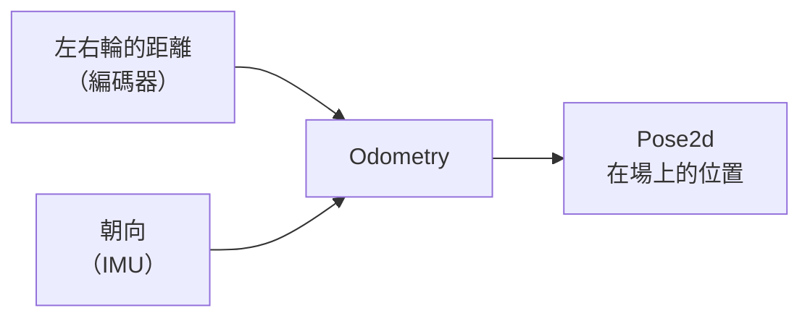

# Odometry

--8<-- "alpha-warning.md"

## 這頁學什麼

- 用 `Pose2d` 描述機器人在場上的位置和朝向
- 場地的座標系統，以及紅藍聯盟的差別
- 用 Odometry（里程計）持續計算機器人的位置
- 在 AdvantageScope 的場地圖上看到機器人

## 觀念

### `Pose2d`：在場上的哪裡、面向哪裡

**`Pose2d`** 包含三個數字：

| 部分 | 意思 | 單位 |
| --- | --- | --- |
| X | 在場地上的 X 座標 | 公尺 |
| Y | 在場地上的 Y 座標 | 公尺 |
| Rotation | 機器人的朝向（`Rotation2d`） | 逆時針為正 |

```java
Pose2d pose = new Pose2d(2.0, 4.0, Rotation2d.fromDegrees(180));

pose.getX();          // 2.0
pose.getY();          // 4.0
pose.getRotation();   // 180 度
```

### 場地座標

WPILib 和 PathPlanner 使用同一套**場地座標**：

- **原點 (0, 0)** 在**藍色聯盟**那一側的右下角（從藍色聯盟的駕駛站往場地看）
- **+X** 從藍色聯盟往紅色聯盟的方向
- **+Y** 往左
- **朝向 0 度**：面向紅色聯盟

```text
        ┌──────────────────────────────────┐
   +Y ▲ │                                  │
      │ │  藍色                      紅色  │
      │ │  聯盟                      聯盟  │
      │ │                                  │
(0,0) └─┴──────────────────────────────────┘──► +X
```

不管你在哪一個聯盟，座標系統都**一樣**。紅色聯盟的機器人開始時面向藍色聯盟，朝向就是 180 度。PathPlanner 會自動幫你處理紅藍聯盟的翻轉（下一頁）。

### Odometry（里程計）

**Odometry** 的做法是：每 20 ms 量一次左右輪各走了多遠、IMU 讀到的朝向，推算出機器人移動了多少，一直累加起來。



WPILib 提供了 **`DifferentialDriveOdometry`**（Swerve 用 `SwerveDriveOdometry`），只要每次迴圈呼叫 `update()` 就好。

**Odometry 的限制**：它是用「累加」的方式算的，輪子打滑、被撞，誤差就會累積，而且無法自己修正。比賽時間越長，誤差越大。[第 10 章](../10-vision/index.md) 會用 AprilTag 修正。

### 重設位置

自動階段開始時，Odometry 要知道機器人的**起始位置**。PathPlanner 的自動程式會自動把位置重設成路徑的起點；自己寫的自動程式則要呼叫 `resetPose(起始位置)`。

## 範例

在 `Drivetrain` 加上 Odometry。先把原本的 `getDistanceMeters()` 拆成左右兩邊：

```java
private static double rotationsToMeters(double motorRotations) {
  return motorRotations / DrivetrainConstants.GEAR_RATIO
      * Math.PI * DrivetrainConstants.WHEEL_DIAMETER_METERS;
}

public double getLeftDistanceMeters() {
  return rotationsToMeters(leftEncoder.getPosition().get(0.0));   // CTRE：leftLeader.getPosition().getValueAsDouble()
}

public double getRightDistanceMeters() {
  return rotationsToMeters(rightEncoder.getPosition().get(0.0));  // CTRE：rightLeader.getPosition().getValueAsDouble()
}

public double getDistanceMeters() {
  return (getLeftDistanceMeters() + getRightDistanceMeters()) / 2;
}
```

加上 Odometry 物件，在建構子的最後建立它（要等馬達設定好之後）：

```java
private final DifferentialDriveOdometry odometry;

public Drivetrain() {
  // ...原本的馬達設定...
  odometry = new DifferentialDriveOdometry(getHeading(), getLeftDistanceMeters(), getRightDistanceMeters());
}
```

在 `periodic()` 裡每次更新，並提供讀取和重設的方法：

```java
public Pose2d getPose() {
  return odometry.getPose();
}

public void resetPose(Pose2d pose) {
  odometry.resetPose(pose);
}

@Override
public void periodic() {
  odometry.update(getHeading(), getLeftDistanceMeters(), getRightDistanceMeters());
  Telemetry.log("Drivetrain/Pose", getPose());
  Telemetry.log("Drivetrain/HeadingDegrees", getHeading().getDegrees());
}
```

完整的 Drivetrain 在 [PathPlanner](pathplanner.md#範例) 那頁。

### 在 AdvantageScope 看機器人的位置

`Telemetry.log("Drivetrain/Pose", getPose())` 會把 `Pose2d` 送到 NetworkTables。

1. 打開 **AdvantageScope**（**WPILib: Start Tool**），連線到機器人
2. 新增一個 **2D Field** 分頁，選擇 2027 的場地
3. 把左側的 `Telemetry/Drivetrain/Pose` 拖到場地上

推著機器人走，場地圖上的機器人應該跟著動。

## 常見錯誤

!!! bug "常見錯誤：場地圖上的機器人往反方向走"
    推機器人往前，圖上卻往後走：編碼器的方向和馬達的方向不一致。確認往前推時 `getLeftDistanceMeters()` 和 `getRightDistanceMeters()` 都**增加**。

!!! bug "常見錯誤：原地轉圈，圖上卻在移動"
    原地轉圈時左右輪的距離會一正一負，平均起來應該接近 0。如果圖上的機器人在移動，檢查左右兩邊是不是有一邊的方向反了。

!!! bug "常見錯誤：中途重設 IMU 或編碼器"
    Odometry 依賴 IMU 和編碼器的**累積**讀值。比賽中重設 IMU（例如第 6 章的 `resetHeadingCommand`）會讓 Odometry 的朝向突然跳動。需要重設時，改用 `resetPose()` 重設整個位置。

## 小練習

1. 在 AdvantageScope 上看到機器人的位置後，推著機器人沿著一個 2 公尺 × 2 公尺的正方形走一圈，回到起點時，Odometry 的誤差有多大？
2. 用力推機器人讓輪子打滑，觀察 Odometry 的變化。這說明了 Odometry 的什麼限制？
3. 如果機器人在藍色聯盟的起始區，面向紅色聯盟，起始位置的 `Pose2d` 的朝向應該是幾度？在紅色聯盟呢？

??? question "第 2 題參考答案"
    輪子打滑時，輪子轉了但機器人沒有跟著走那麼遠，編碼器**多算了距離**，Odometry 以為機器人走得比實際遠。Odometry 只能累加，沒有任何東西告訴它「算錯了」，所以這個誤差會**一直留著**，之後還會繼續累積。要修正就需要外部的參考，例如[第 10 章](../10-vision/index.md)的 AprilTag。

??? question "第 3 題參考答案"
    - 藍色聯盟、面向紅色聯盟：**0 度**（面向 +X 方向）
    - 紅色聯盟、面向藍色聯盟：**180 度**

    不管在哪個聯盟，場地座標都一樣（原點在藍色聯盟那一側），所以紅色聯盟的機器人開始時是面向 -X 方向。
