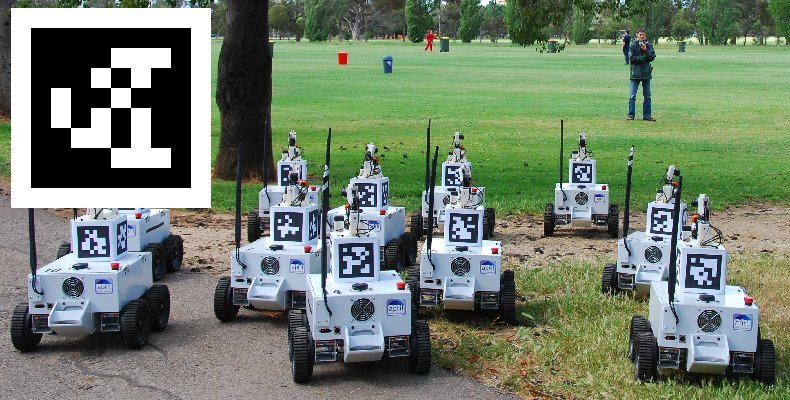
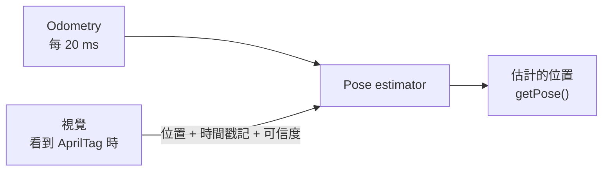

# AprilTag

--8<-- "alpha-warning.md"

## 這頁學什麼

- AprilTag 是什麼、為什麼能用來定位
- 用目標的水平角度 (tx) 對準目標
- Pose estimation：結合 Odometry 和視覺
- MegaTag1 和 MegaTag2 的差別

## 觀念

### AprilTag

**AprilTag** 是一種黑白方塊組成的圖案，有點像 QR code。每個 AprilTag 都有一個**編號 (ID)**，相機看到時可以：

1. 認出它是**幾號**
2. 算出它相對於相機的**位置和角度**

<figure markdown="span">
  { loading=lazy }
  <figcaption>AprilTag：黑白方塊組成的圖案，每個圖案代表一個編號</figcaption>
</figure>

FRC 場地上的固定位置貼了很多 AprilTag，每一個的位置都公布在 **Field layout（場地配置）** 裡。既然知道 AprilTag 在場上的位置，又知道相機看到它的角度和距離，就能**反推出機器人在場上的位置**。

!!! info "2027 的場地"
    2027 的 AprilTag 位置要等 2027 年 1 月 Kickoff 公布比賽題目後才會知道。WPILib 2027 alpha 目前只附了 2026 以前的場地資料。

### 用法一：對準目標

最簡單的用法不需要知道機器人在場上的位置，只需要知道**目標在畫面裡偏多少**：

- **tx**：目標相對於畫面中央的**水平**角度。Limelight 的慣例是**目標在右邊時 tx 為正**
- **ty**：目標的垂直角度

讓 tx 變成 0，機器人就正對著目標了。這正是[第 8 章 PID](../08-control/pid.md) 的工作：目標值是 0，量到的是 tx，PID 算出要轉多快。

```text
目標在右邊 → tx = +10° → PID 輸出負值 → 機器人順時針（往右）轉 → tx 變小
```

完整的寫法在[下一頁](limelight-photonvision.md#對準目標)。

### 用法二：修正機器人的位置

**Pose estimation（姿態估計）** 把兩種來源的位置資訊結合起來：

| 來源 | 優點 | 缺點 |
| --- | --- | --- |
| **Odometry**（編碼器 + IMU） | 每 20 ms 都有資料、短時間內很準 | 誤差會累積，越來越不準 |
| **視覺**（AprilTag） | 不會累積誤差 | 不是隨時都看得到 AprilTag、距離遠時不準、有延遲 |

WPILib 的 **Pose estimator**（例如 `DifferentialDrivePoseEstimator`）平常用 Odometry 更新位置，收到視覺資料時，依照**可信度**把位置往視覺的結果拉過去一些。



兩個重要的觀念：

- **時間戳記 (Timestamp)**：相機拍照、處理需要時間，資料傳到機器人時已經是幾十毫秒前的事了。Pose estimator 會用時間戳記，把視覺資料對應到**拍照當下**的位置
- **標準差 (Standard deviation)**：代表這筆資料**有多不可信**。數字越大越不可信。只看到一個很遠的 AprilTag 時，標準差應該要大；同時看到好幾個很近的 AprilTag 時，標準差可以小

### MegaTag1 和 MegaTag2

Limelight 提供兩種用 AprilTag 計算機器人位置的方法：

| | MegaTag1 | MegaTag2 |
| --- | --- | --- |
| 需要什麼 | 只用相機 | 相機 + 機器人告訴它目前的**朝向** |
| 只看到一個 AprilTag 時 | 容易不準，位置會跳動 | 穩定很多 |
| 什麼時候用 | 機器人朝向還不確定時（例如剛開機） | 大部分時候 |

MegaTag2 的做法是：既然 IMU 已經很準地知道機器人的朝向，就把朝向告訴 Limelight，它只需要算 X、Y。所以使用 MegaTag2 時，程式每次迴圈都要把朝向送給 Limelight。

## 常見錯誤

!!! bug "常見錯誤：tx 的方向弄反"
    把 PID 的輸出直接當作轉向，結果機器人越轉離目標越遠。檢查 tx 的正負方向，和 `arcadeDrive` 旋轉的方向（逆時針為正）是不是對得上。

!!! bug "常見錯誤：視覺資料完全不加過濾"
    相機偶爾會誤判（例如看到反光、只看到 AprilTag 的一角），算出一個離譜的位置。直接拿來用，機器人的位置會突然跳到場地另一邊。要檢查資料是否有效，並給適當的標準差。

!!! bug "常見錯誤：相機的安裝位置沒設定"
    相機算出的是**相機**在場上的位置。要換算成**機器人中心**的位置，必須告訴視覺系統相機裝在機器人的哪裡、朝向哪裡。量錯了，位置就會有固定的偏差。

## 小練習

1. 想一想：機器人在場上哪些地方看得到 AprilTag？哪些地方看不到？看不到的時候 Pose estimator 怎麼辦？
2. 為什麼距離越遠，視覺算出的位置越不準？
3. 自動階段一開始，機器人的朝向是從哪裡來的？這對 MegaTag2 有什麼影響？

??? question "第 1 題參考答案"
    AprilTag 貼在場地的固定位置，相機要**面向**它、而且**距離夠近**才看得到。機器人在場地中間背對所有 AprilTag、被其他機器人擋住，或相機視野裡剛好沒有 AprilTag 時就看不到。

    看不到的時候，Pose estimator 就**只靠 Odometry** 繼續更新位置。等到再次看到 AprilTag，再把累積的誤差修正回來。

??? question "第 2 題參考答案"
    距離越遠，AprilTag 在畫面裡越**小**，只佔很少的像素。角落位置差一個像素，算出來的角度和距離誤差就會很大；再加上角度的小誤差乘上很長的距離，算出的位置誤差也跟著放大。所以距離遠時標準差要設大一點，讓 Pose estimator 少相信它一點。

??? question "第 3 題參考答案"
    自動階段開始時，PathPlanner 會把位置重設成路徑的起點（包含朝向），或是你的程式呼叫 `resetPose(起始位置)`。如果機器人實際擺放的方向和程式以為的不一樣（例如紅色聯盟應該是 180 度，程式卻以為是 0 度），MegaTag2 拿到的朝向就是錯的，算出來的位置也會錯。所以**擺放機器人的方向要和起始位置一致**。
