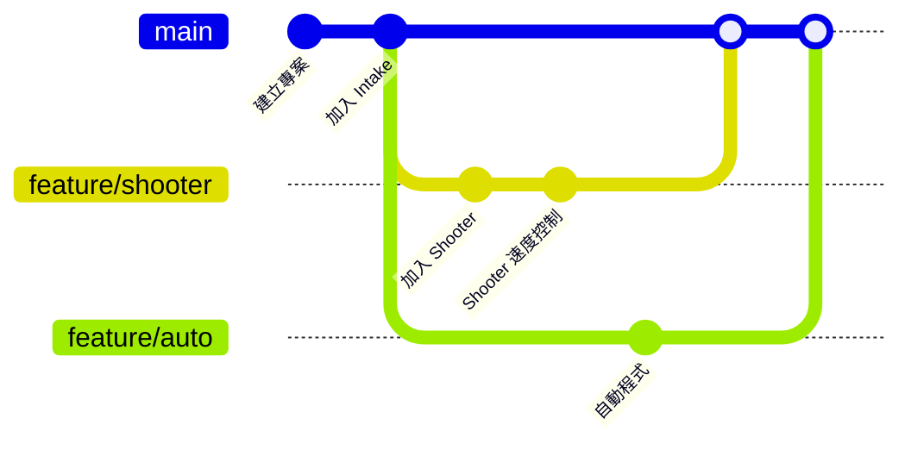

# 用 Git 分工

## 這頁學什麼

- Git 是什麼、為什麼程式組一定要用
- Commit、Branch、Remote 的觀念
- 在 VS Code 和命令列使用 Git
- 用 Branch 和 Pull request 和隊友分工
- 比賽期間的版本管理

## 觀念

### 為什麼要用 Git

沒有版本管理的程式組，常常遇到這些狀況：

- 「昨天還能動，今天改了一些東西就壞了，但不記得改了什麼」
- 「兩個人同時改了同一個檔案，其中一個人的修改不見了」
- 「比賽用的是哪一版程式？那台筆電上的是最新的嗎？」

**Git** 是版本管理工具，它記錄程式碼的**每一個版本**，隨時可以回到以前的版本、比較兩個版本的差別，也能讓很多人同時修改同一個專案。

### 三個核心觀念

| 觀念 | 意思 | 比喻 |
| --- | --- | --- |
| **Commit（提交）** | 把目前的修改存成一個版本，附上說明 | 遊戲的存檔點 |
| **Branch（分支）** | 從某個版本分出去，獨立修改，不影響主線 | 平行世界 |
| **Remote（遠端）** | 放在網路上（例如 GitHub）的共用版本 | 雲端硬碟 |



### 隊上的分工方式

建議的做法：

1. **`main` 分支永遠保持「可以上場」的狀態**：部署到比賽機器人的程式一定來自 `main`
2. **每個功能開一個 Branch**：例如 `feature/shooter`、`feature/auto-two-piece`
3. **完成後開 Pull request (PR)**：請另一位隊員看過程式碼、在機器人上測試過，再合併回 `main`

一個 Subsystem 一個檔案的 [Command-based 架構](../05-commands/why.md#把機構和動作分開)在這裡很有幫助：負責 Shooter 的人改 `Shooter.java`，負責自動程式的人改 `Autos.java`，兩個人很少會改到同一個地方。

## 步驟

### 第一次設定

WPILib 建立的專案已經附了 `.gitignore`，會自動排除編譯產生的檔案。在專案資料夾初始化 Git：

```bash
git init
git add .
git commit -m "Create robot project"
```

在 GitHub 建立一個 repository，照著 GitHub 上的說明把專案推上去，隊友就能下載 (clone) 下來。

### 日常的流程

```bash
git switch main
git pull
git switch -c feature/shooter-velocity
```

改完、在機器人上測試過之後：

```bash
git add .
git commit -m "Use velocity control for shooter"
git push -u origin feature/shooter-velocity
```

然後在 GitHub 上開 Pull request。

!!! tip "小技巧：用 VS Code 操作 Git"
    不想打指令的話，VS Code 左側的 **Source Control（原始碼控制）** 面板可以做大部分的事：看有哪些檔案改了、比較修改內容、輸入說明後 commit、push。左下角可以切換 Branch。

### 好的 commit 習慣

- **一個 commit 做一件事**：「加入 Shooter 的速度控制」，而不是「今天改的東西」
- **能動的時候就 commit**：在機器人上測試過、確定能動，就存一次。改壞了才有地方可以回去
- **說明寫清楚做了什麼**：一個月後的你會感謝現在的你

### 比賽期間的版本管理

- **每次部署前都 commit**：這樣就知道機器人上跑的是哪一版
- **每場比賽前打一個標籤 (Tag)**：例如 `git tag qual-12`，之後可以回頭查第 12 場資格賽用的是哪一版
- **緊急修改也要 commit**：在 pit 臨時改的程式，修好之後一定要 commit，否則回到學校就找不到了

```bash
git commit -am "Lower arm speed for field carpet"
git tag qual-12
```

## 常見錯誤

!!! bug "常見錯誤：好幾台筆電上的程式不一樣"
    A 筆電改了 Intake、B 筆電改了自動程式，比賽時部署哪一台都會少一個功能。所有修改都要 push 到 GitHub、合併回 `main`，部署前先 `git pull`。

!!! bug "常見錯誤：合併衝突 (Merge conflict)"
    兩個人改了同一個檔案的同一個地方，Git 不知道要用哪一個，會在檔案裡標出 `<<<<<<<`、`=======`、`>>>>>>>`。打開檔案，決定要保留哪些內容，刪掉這些標記，再 commit。不確定的時候，找改了另一邊的隊友一起看。

!!! bug "常見錯誤：把 `build/` 資料夾 commit 進去"
    編譯產生的檔案每次都會變，commit 進去會讓 repository 變得很大、一直出現衝突。WPILib 的 `.gitignore` 已經排除了，不要刪掉它。

## 小練習

1. 把你的機器人專案放上 GitHub，邀請隊友加入。
2. 開一個 Branch，改一個小地方（例如 Intake 的速度），開 Pull request，請隊友 review 後合併。
3. 故意和隊友同時改 `Constants.java` 的同一行，練習解決合併衝突。
