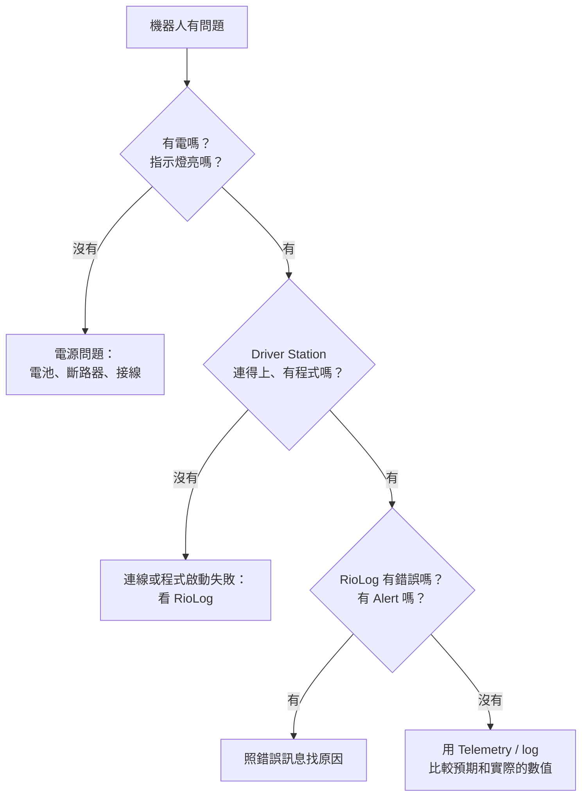

# 常見錯誤排查

--8<-- "alpha-warning.md"

## 這頁學什麼

- 有系統地找出問題，而不是亂改程式
- 常見症狀的可能原因和檢查方法

## 觀念

### 排查的步驟

機器人出問題時，最常見的錯誤是**馬上開始改程式**。很多問題根本不是程式造成的。照著這個順序：

1. **重現問題**：問清楚是什麼時候、做了什麼操作、發生了什麼事。能穩定重現，才能確定修好了沒
2. **看資料**：Driver Station 的訊息、RioLog 的錯誤、[AdvantageScope 的 log](logging.md)
3. **縮小範圍**：是**電源**、**接線**、**韌體 / 設定**，還是**程式**？
4. **一次只改一個地方**：改了就測試。一次改很多個地方，就算修好了也不知道是哪一個修好的
5. **記錄下來**：問題、原因、解法。下次遇到同樣的問題就能馬上解決

## 常見症狀

### 連線和部署

??? failure "部署時找不到機器人"
    - 電腦有沒有連上 Systemcore？用瀏覽器打開 `http://robot.local` 試試
    - 專案的隊號（`.wpilib/wpilib_preferences.json`）和 Systemcore 設定的一樣嗎？
    - 防火牆或防毒軟體有沒有擋住？

??? failure "第一次部署（或在比賽會場）編譯失敗"
    - 加入 vendordep 後的第一次編譯需要網路。出發前要在有網路的地方編譯過（[第 3 章](../03-setup/further.md#比賽前的離線準備)）
    - WPILib 和 vendordep 的版本是否對應（[版本對照](../03-setup/index.md#版本對照)）

??? failure "Driver Station 顯示沒有機器人程式"
    程式一啟動就當掉了。打開 RioLog 看第一段錯誤訊息，常見原因：

    - 建構子或欄位初始化時發生 `NullPointerException`（例如 `RobotContainer` 的欄位順序錯了）
    - 改了 `Robot` 的類別名稱或 package，`Main.java` 沒跟著改
    - 同一個 CAN 裝置或 Smart IO 埠被 `new` 了兩次

### 馬達和機構

??? failure "馬達完全不動"
    1. 機器人有 Enable 嗎？是正確的模式嗎？
    2. 馬達控制器的指示燈亮嗎？是什麼顏色、閃燈方式（對照廠商文件）？
    3. 程式裡的 `CANPort` 和 CAN ID 和實際接線一樣嗎？用 REV Hardware Client 2 / Phoenix Tuner X 確認
    4. RioLog 有沒有「找不到裝置」之類的錯誤？
    5. 有 Command 在控制這個機構嗎？在 Telemetry 顯示 Subsystem 目前的 Command 看看
    6. 韌體版本和 vendordep 版本對應嗎？

??? failure "馬達往反方向轉"
    設定裡的反轉（[第 6 章](../06-motors-sensors/motor-config.md#inverted反轉)），或是搖桿的正負號（[第 4 章](../04-robot-basics/gamepad.md#讀搖桿和板機)）。

??? failure "機構一直抖動、來回震盪"
    - PID 的 kP 太大，或 kD 太大（[第 8 章](../08-control/pid.md#手動調-pid-的步驟)）
    - 有兩個 Command 同時在控制同一顆馬達？（例如在 `periodic()` 裡設定了馬達輸出）
    - 感測器讀值本身在跳動？先在 Telemetry 看感測器的原始讀值

??? failure "機構一下動一下不動"
    - 接頭鬆了：輕輕搖晃接線，看問題會不會出現
    - CAN 線接觸不良：RioLog 會出現大量 CAN 錯誤
    - 電流限制太低、或觸發了 Brownout：看 log 的電流和電池電壓

### 程式行為

??? failure "按按鈕沒有反應"
    - `CommandScheduler.getInstance().run()` 還在 `robotPeriodic()` 裡嗎？
    - 綁定是寫在 `configureBindings()` 裡，而且有被呼叫嗎？
    - 手把的編號對嗎？在 Driver Station 確認
    - 綁定的 Command 是不是馬上就結束了（例如用了 `runOnce`）？

??? failure "RioLog 出現「Loop time of 0.02s overrun」"
    某個 `periodic()` 或 Command 執行太久。常見原因：

    - 在 `periodic()` 裡做了耗時的事（大量的 `println`、檔案讀寫、複雜的計算）
    - 用了 `Thread.sleep()` 或迴圈等待（[第 4 章](../04-robot-basics/lifecycle.md#periodic-不能卡住)）

    偶爾出現一次通常沒關係（例如程式剛啟動時），一直出現就要處理。

??? failure "自動程式沒有執行"
    - Elastic 上的自動程式**選了**嗎？預設選項是什麼？
    - `getAutonomousCommand()` 回傳的是不是 `null`？
    - 自動程式用到的 Subsystem 有沒有被其他 Command 搶走？
    - 用 PathPlanner 的話：Named commands 有沒有在建立選單之前註冊？`AutoBuilder` 有沒有設定成功（RioLog 有沒有「無法讀取 PathPlanner 的機器人設定」）？

??? failure "紅色聯盟時自動程式走錯"
    - Driver Station 的聯盟顏色設定對嗎？
    - PathPlanner 的翻轉條件（[第 9 章](../09-autonomous/pathplanner.md#autobuilder)）
    - 機器人擺放的位置和方向對嗎？

### 電源

??? failure "比賽中機器人突然沒力、停頓幾秒"
    很可能是 **Brownout**：電池電壓掉得太低，系統暫時關掉馬達輸出。

    - 看 log 的電池電壓，找出電壓最低的時間點
    - 那時候哪些馬達的電流最大？有沒有設定[電流限制](../06-motors-sensors/motor-config.md#current-limit電流限制)？
    - 電池是充飽的嗎？電池用了幾年？
    - 主斷路器和電池的接頭有沒有鬆？

## 常見錯誤

!!! bug "常見錯誤：問題沒有重現就說修好了"
    改了一個地方，測一次剛好正常，就以為修好了。偶發的問題要多測幾次，最好能找出「為什麼會這樣」，才確定真的修好。

!!! bug "常見錯誤：為了修 A 改壞了 B"
    在比賽現場匆忙修改，結果改到別的功能。修改後除了測試出問題的地方，也要快速測一遍其他機構。

## 小練習

1. 和隊友玩「故障排除」遊戲：一個人偷偷製造一個問題（拔掉一條 CAN 線、改錯一個 CAN ID、把手把順序對調），另一個人照著步驟找出原因。
2. 建立隊上的「問題紀錄」文件，記錄每次遇到的問題、原因和解法。
3. 回想一次你遇到的問題，用上面的流程圖重新走一遍，看看能不能更快找到原因。
