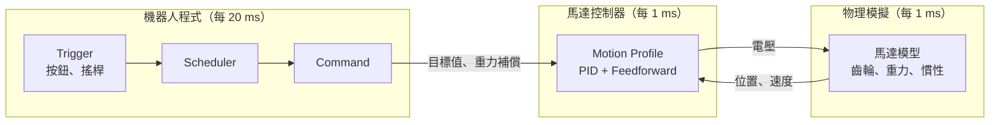

# 第 12 章 機構範例

這一章是**可以直接在網頁上玩的機構模擬器**。每一頁都有一個 3D 的機構，加上和前面章節一樣的控制方式：PID、Feedforward、Motion Profile，以及 Command-based 的按鍵綁定。不用機器人、不用安裝任何東西，打開網頁就能調參數、按按鈕，看看機構會怎麼動。

## 這章學什麼

- 親手調 PID 和 Feedforward，觀察每個參數的效果
- 看到 Motion Profile 讓機構平順移動的樣子
- 看到 Command Scheduler 怎麼啟動、中斷 Command
- 在真的機器人上調參數之前，先建立直覺

**需要先讀**：[第 5 章 Command-based 架構](../05-commands/index.md)、[第 8 章 控制入門](../08-control/index.md)

## 模擬器怎麼運作

每個模擬器都照著真實機器人的方式運作：

- **機器人程式**每 20 ms 執行一次 Command Scheduler，和[第 5 章](../05-commands/why.md#scheduler-在做什麼)講的一樣
- **馬達控制器**每 1 ms 計算一次 PID 和 Feedforward，和[第 8 章](../08-control/index.md#在哪裡算systemcore-還是馬達控制器)講的「在控制器上算」一樣
- **物理模擬**用和 WPILib `DCMotor` 相同的馬達模型，計算電壓、轉速和扭力的關係，再加上齒輪比、重力和慣性

!!! info "這不是真正的機器人程式"
    瀏覽器沒辦法執行 WPILib 的 Java 程式，所以模擬器是用 JavaScript 重寫同樣的邏輯。觀念和行為都和前面章節的程式一致，但**參數不能直接搬到真的機器人上**：真實機構的重量、摩擦、齒輪間隙都不一樣，還是要用 [SysId](../08-control/sysid.md) 量測、實際調整。

## 操作方式

| 操作 | 方式 |
| --- | --- |
| 旋轉視角 | 在 3D 畫面上拖曳 |
| 縮放 | 滾輪，或兩指縮放 |
| 平移 | 右鍵拖曳，或兩指拖曳 |
| 啟用機器人 | 按 **Enable**。和真的機器人一樣，沒有 Enable 時馬達不會動 |
| 放慢時間 | 調低「模擬速度」，看清楚每個細節 |

## 本章內容

| 小節 | 內容 |
| --- | --- |
| [手臂 Arm](arm.md) | 重力補償、PID、Motion Profile、Command 的中斷 |
| [飛輪 Shooter](flywheel.md) | 開迴路和速度控制、電池電量的影響、發射流程 |
| [升降機構 Elevator](elevator.md) | 固定重力 kG、重量改變時的影響 |
| [底盤 Drivetrain](drivetrain.md) | 開車、TurnToAngle、Odometry 漂移、AprilTag 修正、自動程式 |
