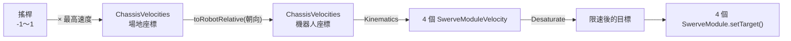

# Drivetrain

--8<-- "alpha-warning.md"

## 這頁學什麼

- 用一個陣列管理四個模組
- 從 `ChassisVelocities` 算出四個模組的目標：Kinematics 和 Desaturate
- 場地座標控制：用 IMU 把駕駛的輸入轉成機器人座標
- 把搖桿接到 `driveCommand`

## 觀念

### 從「機器人怎麼動」到「每個輪子怎麼動」



每一步都是[第 7 章 Swerve 入門](../07-drivetrain/swerve.md) 講過的觀念，這一頁把它們串起來。

### Desaturate：超速時等比例縮小

同時全速往前又全速自轉，Kinematics 可能算出某個輪子要跑 6 m/s，但馬達最快只能 4.5 m/s。如果只把那個輪子限制在 4.5，其他輪子不變，四個輪子的速度比例就亂了，機器人會往奇怪的方向跑。

**`desaturateWheelVelocities(targets, MAX_SPEED)`** 把四個輪子**一起**等比例縮小，讓最快的那個剛好是 `MAX_SPEED`。方向不變，只是整體變慢。

注意它會**回傳一個新的陣列**，要接住回傳值：

```java
targets = SwerveDriveKinematics.desaturateWheelVelocities(targets, SwerveConstants.MAX_SPEED);
```

### 場地座標的「前方」從哪裡來

這一章的場地座標很簡單：**IMU 重設時機器人面向哪裡，那裡就是「前方」**。駕駛讓機器人面向遠離自己的方向，按下 Start 鍵重設 IMU，之後推搖桿往前，機器人就往遠離駕駛的方向走。

[第 16 章](../16-swerve-auto/odometry.md) 加上 Odometry 之後，會改成用真正的場地座標，並處理紅藍聯盟的差別。

## 範例

### Drivetrain

```java title="src/main/java/first/robot/subsystems/Drivetrain.java"
package first.robot.subsystems;

import first.robot.Constants.SwerveConstants;
import java.util.function.DoubleSupplier;
import org.wpilib.command2.Command;
import org.wpilib.command2.SubsystemBase;
import org.wpilib.hardware.imu.OnboardIMU;
import org.wpilib.hardware.imu.OnboardIMU.MountOrientation;
import org.wpilib.math.geometry.Rotation2d;
import org.wpilib.math.kinematics.ChassisVelocities;
import org.wpilib.math.kinematics.SwerveDriveKinematics;
import org.wpilib.math.kinematics.SwerveModuleVelocity;
import org.wpilib.telemetry.Telemetry;

public class Drivetrain extends SubsystemBase {
  // 順序固定是左前、右前、左後、右後，Kinematics 也用同樣的順序
  private final SwerveModule[] modules = {
    new SwerveModule(SwerveConstants.FRONT_LEFT),
    new SwerveModule(SwerveConstants.FRONT_RIGHT),
    new SwerveModule(SwerveConstants.BACK_LEFT),
    new SwerveModule(SwerveConstants.BACK_RIGHT),
  };

  private final SwerveDriveKinematics kinematics =
      new SwerveDriveKinematics(
          SwerveConstants.FRONT_LEFT.location(),
          SwerveConstants.FRONT_RIGHT.location(),
          SwerveConstants.BACK_LEFT.location(),
          SwerveConstants.BACK_RIGHT.location());

  private final OnboardIMU imu = new OnboardIMU(MountOrientation.FLAT);

  // ---------- 感測器 ----------

  /** 機器人的朝向，逆時針為正。 */
  public Rotation2d getHeading() {
    return imu.getRotation2d();
  }

  /** 四個模組目前的速度和角度。 */
  public SwerveModuleVelocity[] getModuleVelocities() {
    SwerveModuleVelocity[] velocities = new SwerveModuleVelocity[modules.length];
    for (int i = 0; i < modules.length; i++) {
      velocities[i] = modules[i].getVelocity();
    }
    return velocities;
  }

  // ---------- 控制 ----------

  /** 用機器人座標的速度移動：vx 往前、vy 往左、omega 逆時針。 */
  public void driveRobotRelative(ChassisVelocities velocities) {
    SwerveModuleVelocity[] targets = kinematics.toSwerveModuleVelocities(velocities);
    targets = SwerveDriveKinematics.desaturateWheelVelocities(targets, SwerveConstants.MAX_SPEED);
    for (int i = 0; i < modules.length; i++) {
      modules[i].setTarget(targets[i]);
    }
    Telemetry.log("Drivetrain/TargetVelocities", targets);
  }

  /** 用場地座標的速度移動：不管機器人面向哪裡，vx 都是往場地的前方。 */
  public void driveFieldRelative(ChassisVelocities velocities) {
    driveRobotRelative(velocities.toRobotRelative(getHeading()));
  }

  public void stop() {
    for (SwerveModule module : modules) {
      module.stop();
    }
  }

  // ---------- Command ----------

  /**
   * 用搖桿開車（場地座標）。三個輸入的範圍都是 -1～1。
   *
   * @param forward 往前
   * @param left 往左
   * @param rotation 逆時針旋轉
   */
  public Command driveCommand(DoubleSupplier forward, DoubleSupplier left, DoubleSupplier rotation) {
    return run(() -> driveFieldRelative(
            new ChassisVelocities(
                forward.getAsDouble() * SwerveConstants.MAX_SPEED,
                left.getAsDouble() * SwerveConstants.MAX_SPEED,
                rotation.getAsDouble() * SwerveConstants.MAX_ANGULAR_SPEED)))
        .finallyDo(this::stop)
        .withName("SwerveDrive");
  }

  /** 把目前的朝向設為 0 度：駕駛讓機器人面向遠離自己的方向，再按這個按鈕。 */
  public Command resetHeadingCommand() {
    return runOnce(imu::resetYaw).ignoringDisable(true).withName("ResetHeading");
  }

  @Override
  public void periodic() {
    Telemetry.log("Drivetrain/ModuleVelocities", getModuleVelocities());
    Telemetry.log("Drivetrain/HeadingDegrees", getHeading().getDegrees());
  }
}
```

- **模組陣列的順序很重要**：`kinematics.toSwerveModuleVelocities()` 回傳的陣列，順序和建立 `SwerveDriveKinematics` 時傳入位置的順序一樣。`modules` 陣列要用同樣的順序，`targets[i]` 才會交給正確的模組
- **`driveRobotRelative` 和 `driveFieldRelative` 分開**：駕駛用場地座標，[第 16 章](../16-swerve-auto/pathplanner.md) 的 PathPlanner 會用機器人座標
- **`Telemetry.log` 可以直接記錄 `SwerveModuleVelocity[]`**：[第一次上電](first-drive.md) 會在 AdvantageScope 用它畫出四個輪子

### RobotContainer

```java title="src/main/java/first/robot/RobotContainer.java"
package first.robot;

import first.robot.Constants.OperatorConstants;
import first.robot.subsystems.Drivetrain;
import org.wpilib.command2.Command;
import org.wpilib.command2.Commands;
import org.wpilib.command2.button.CommandGamepad;
import org.wpilib.math.util.MathUtil;

public class RobotContainer {
  private final Drivetrain drivetrain = new Drivetrain();

  private final CommandGamepad driver = new CommandGamepad(OperatorConstants.DRIVER_CONTROLLER_PORT);

  public RobotContainer() {
    configureDefaultCommands();
    configureBindings();
  }

  /** 搖桿放開時不一定剛好是 0，中間 10% 當作 0。 */
  private static double deadband(double input) {
    return MathUtil.applyDeadband(input, 0.1);
  }

  private void configureDefaultCommands() {
    // 搖桿往前推是負值、往右推是正值，所以三個都要加負號
    drivetrain.setDefaultCommand(
        drivetrain.driveCommand(
            () -> deadband(-driver.getLeftY()),
            () -> deadband(-driver.getLeftX()),
            () -> deadband(-driver.getRightX())));
  }

  private void configureBindings() {
    driver.start().onTrue(drivetrain.resetHeadingCommand());
  }

  public Command getAutonomousCommand() {
    return Commands.none();
  }
}
```

三個負號是最容易搞錯的地方：

| 搖桿 | 推的方向 | 讀到的值 | 我們要的 |
| --- | --- | --- | --- |
| 左搖桿 Y | 往前推 | 負 | 往前（+X），所以加負號 |
| 左搖桿 X | 往右推 | 正 | 往右是 −Y，所以加負號 |
| 右搖桿 X | 往右推 | 正 | 順時針是負的 omega，所以加負號 |

**`MathUtil.applyDeadband(input, 0.1)`**：搖桿放開時，讀值常常是 0.02、−0.03 這種很小的數字。對差速底盤來說只是輪子微微轉一下，但對 Swerve 來說，就算速度很小，Kinematics 也會算出一個**方向**，四個輪子會跟著搖桿的雜訊亂轉。Deadband（死區）把 −0.1～0.1 之間都當作 0，放開搖桿時輪子才會停在原本的角度。[第 14 章](../14-swerve-tuning/driver-input.md) 會再調整搖桿的手感。

## 常見錯誤

!!! bug "常見錯誤：模組陣列和 Kinematics 的順序不一樣"
    `modules` 陣列是「左前、右前、左後、右後」，Kinematics 卻是「左前、左後、右前、右後」，結果左後的目標交給了右前。往前開還看不出來（四個輪子都朝前），一旋轉就亂掉。

!!! bug "常見錯誤：沒有接住 `desaturateWheelVelocities` 的回傳值"
    只寫 `SwerveDriveKinematics.desaturateWheelVelocities(targets, MAX_SPEED);`，沒有 `targets =`，原本的陣列不會被修改，限速就沒有作用。

!!! bug "常見錯誤：角速度的單位"
    `MAX_ANGULAR_SPEED` 是弧度 / 秒，不是度 / 秒（[第 7 章常見錯誤](../07-drivetrain/swerve.md#常見錯誤)）。

## 小練習

1. 機器人面向 90 度（左方）時，駕駛推搖桿往前。`toRobotRelative` 之後的 `vx`、`vy` 是多少？四個輪子會指向幾度？
2. 寫一個 `public Command driveRobotRelativeCommand(...)`：和 `driveCommand` 一樣，但用機器人座標。綁在一個按鈕上，比較兩種座標的手感。
3. 為什麼 `driveCommand` 要加 `.finallyDo(this::stop)`？

??? question "第 1 題參考答案"
    場地座標的「前方」是機器人的**右方**，所以 `vx = 0`、`vy = −速度`（往右）。四個輪子都指向 **−90 度**。這就是[第 7 章範例](../07-drivetrain/swerve.md#kinematics運動學) 的最後一個情況。

??? question "第 2 題參考答案"
    ```java
    public Command driveRobotRelativeCommand(
        DoubleSupplier forward, DoubleSupplier left, DoubleSupplier rotation) {
      return run(() -> driveRobotRelative(
              new ChassisVelocities(
                  forward.getAsDouble() * SwerveConstants.MAX_SPEED,
                  left.getAsDouble() * SwerveConstants.MAX_SPEED,
                  rotation.getAsDouble() * SwerveConstants.MAX_ANGULAR_SPEED)))
          .finallyDo(this::stop)
          .withName("SwerveDriveRobotRelative");
    }
    ```

    ```java
    // 在 configureBindings() 裡：按住右肩鍵時用機器人座標
    driver.rightBumper().whileTrue(
        drivetrain.driveRobotRelativeCommand(
            () -> -driver.getLeftY(), () -> -driver.getLeftX(), () -> -driver.getRightX()));
    ```

??? question "第 3 題參考答案"
    TalonFX 收到速度目標之後，會一直維持那個速度，直到收到新的指令。`driveCommand` 被另一個也佔用 `Drivetrain` 的 Command 中斷時（例如 `resetHeadingCommand`，它是用 `runOnce` 建立的，也會佔用 `Drivetrain`），如果新的 Command 不控制馬達，輪子就會繼續用最後的速度滾。`finallyDo(this::stop)` 確保 Command 結束時一定把馬達停下來。
