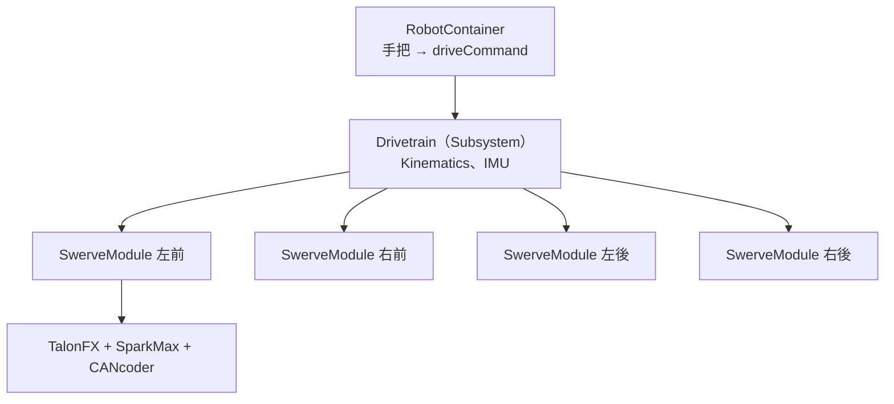

# 第 13 章 從零打造 Swerve：讓它動起來

--8<-- "alpha-warning.md"

[第 7 章的 Swerve 入門](../07-drivetrain/swerve.md) 建議第一次做 Swerve 時用現成的方案。這一章到第 18 章反過來：**不用任何 Swerve 函式庫，自己從頭寫一套 Swerve**。寫過一次，你會真正理解現成方案裡每一個參數在做什麼，出問題時也知道從哪裡查起。

## 為什麼要自己寫

| | 現成方案（YAGSL、CTRE Swerve Generator） | 自己寫 |
| --- | --- | --- |
| 上手速度 | 快，填好參數就能動 | 慢，要寫好幾個類別 |
| 理解程度 | 參數錯了不容易知道為什麼 | 每一行都知道在做什麼 |
| 彈性 | 受限於函式庫支援的硬體 | 任何硬體組合都能寫 |

這幾章用的是一個**混搭**的組合：驅動用 CTRE 的 TalonFX，轉向用 REV 的 SparkMax。全部用 CTRE 或全部用 REV 都有官方的現成方案，但混搭就只能靠自己。混搭也剛好讓你同時看到兩家的寫法。

## 這幾章的硬體

| 元件 | 用途 | 程式類別 |
| --- | --- | --- |
| **TalonFX**（Kraken X60） | 驅動馬達，讓輪子滾動 | `TalonFX`（Phoenix 6） |
| **SparkMax** + NEO | 轉向馬達，讓輪子轉向 | `SparkMax`（REVLib） |
| **CANcoder** | 量輪子指向的絕對角度 | `CANcoder`（Phoenix 6） |
| **Systemcore 內建 IMU** | 量機器人的朝向 | `OnboardIMU`（WPILib） |

!!! info "為什麼不用 navX"
    Studica 的 2027 函式庫（StudicaLib 2027.0.0-alpha-1）目前只支援 **navX3**，navX2 在 2027 還沒有官方支援。Systemcore 內建的 IMU 不需要額外接線，所以這幾章直接使用它，用法和[第 6 章](../06-motors-sensors/gyro.md)一樣。

## 路線

| 章節 | 做完之後 |
| --- | --- |
| **第 13 章 讓它動起來**（這章） | 可以用手把以場地座標開 Swerve |
| [第 14 章 優化與調整](../14-swerve-tuning/index.md) | 轉向更快更準、駕駛手感更好、參數調好 |
| [第 15 章 模擬](../15-swerve-sim/index.md) | 沒有機器人也能在電腦上測試 Swerve 程式 |
| [第 16 章 自動階段](../16-swerve-auto/index.md) | Odometry、PathPlanner、視覺修正位置 |
| [第 17 章 進階](../17-swerve-advanced/index.md) | 254 的 Setpoint Generator、加速度 Feedforward、保持朝向 |
| [第 18 章 硬體抽象化與 AdvantageKit](../18-hardware-abstraction/index.md) | 硬體和邏輯分開，比賽的 log 可以拿回來重播 |

## 程式的架構

- **`SwerveModule`**：管一個模組的三個硬體，負責「轉到某個角度、用某個速度滾」
- **`Drivetrain`**：整個底盤的 Subsystem，把「機器人要怎麼動」換算成四個模組各自的目標
- **`RobotContainer`**：把手把的搖桿接到 `Drivetrain` 的 Command

## 這章學什麼

- Swerve 模組的硬體、齒輪比和單位換算
- 規劃 CAN ID、量測 CANcoder 的零點
- 寫 `SwerveModule`：TalonFX 速度控制、Systemcore 上的轉向 PID
- 寫 `Drivetrain`：Kinematics、限速、場地座標控制
- 第一次上電時，一步一步確認每個方向都正確

**需要先讀**：[第 5 章 Command-based 架構](../05-commands/index.md)、[第 6 章 馬達與感測器](../06-motors-sensors/index.md)、[第 7 章 Swerve 入門](../07-drivetrain/swerve.md)、[第 8 章 PID](../08-control/pid.md) 和 [Feedforward](../08-control/feedforward.md)

## 本章內容

| 小節 | 內容 |
| --- | --- |
| [硬體與常數](hardware.md) | 模組構造、齒輪比、CAN ID、CANcoder 零點、`Constants.java` |
| [SwerveModule](module.md) | 一個模組的程式：驅動、轉向、絕對式編碼器 |
| [Drivetrain](drivetrain.md) | 四個模組組成底盤：Kinematics、IMU、場地座標控制 |
| [第一次上電](first-drive.md) | 架高機器人，一步一步確認方向和讀值 |
| [延伸學習](further.md) | 全 REV / 全 CTRE 的差異、CAN 匯流排分配 |
