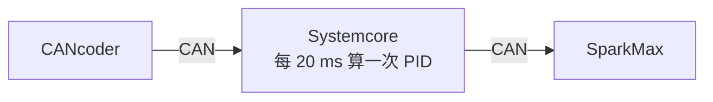

# SparkMax 轉向 PID

--8<-- "alpha-warning.md"

## 這頁學什麼

- 為什麼要把轉向的 PID 搬到 SparkMax 上
- **Seeding（校正）**：開機時用 CANcoder 設定 NEO 編碼器的位置
- **Position wrapping**：讓 SparkMax 知道角度是一個圓
- 單位：SparkMax 的位置一律是**馬達**的圈數

## 觀念

### 為什麼要搬

[第 13 章](../13-swerve-drive/module.md) 的轉向 PID 在 Systemcore 上算：



每 20 ms 才更新一次，而且讀值和指令都要經過 CAN，各有幾毫秒的延遲。[第 8 章](../08-control/index.md#在哪裡算systemcore-還是馬達控制器) 說過，PID 放在馬達控制器上每 1 ms 算一次，反應會好很多。

問題是 SparkMax **讀不到 CANcoder**：CANcoder 是 CTRE 的裝置，SparkMax 的 PID 只能用接在它身上的感測器，例如 NEO 的內建編碼器。

### Seeding：用 CANcoder 校正內建編碼器

NEO 的內建編碼器是相對式的，開機時是 0。但只要**開機時告訴它正確的位置**，之後它就能一直追蹤：

```text
開機時 CANcoder 讀到 0.25 圈（輪子指向左方）
→ NEO 的編碼器設為 0.25 × 21.43 = 5.36 圈（馬達的圈數）
→ 之後 NEO 轉了多少，輪子就轉了多少 ÷ 21.43
```

```java
public void syncSteerEncoder() {
  double moduleRotations = encoder.getAbsolutePosition().waitForUpdate(0.1).getValueAsDouble();
  steerEncoder.setPosition(moduleRotations * SwerveConstants.STEER_GEAR_RATIO);
}
```

`waitForUpdate(0.1)` 會等 CANcoder 送來**新的**讀值（最多等 0.1 秒）。剛開機時 CANcoder 可能還沒送過資料，直接讀可能讀到 0。

### Position wrapping：SparkMax 版的 Continuous input

和 `enableContinuousInput` 一樣，SparkMax 也要知道角度是一個圓。差別是它的單位是**馬達的圈數**：輪子轉一圈是 21.43 圈馬達。

```java
config.closedLoop
    .positionWrappingEnabled(true)
    .positionWrappingInputRange(-STEER_GEAR_RATIO / 2, STEER_GEAR_RATIO / 2);
```

範圍是 −10.71～10.71 圈馬達，也就是輪子的 −180～180 度。目標值也要換算成馬達的圈數：

```java
steerController.setSetpoint(target.angle.getRotations() * STEER_GEAR_RATIO, ControlType.kPosition);
```

### kP 的單位變了

| | Systemcore 的 `PIDController` | SparkMax 的 PID |
| --- | --- | --- |
| 誤差的單位 | 弧度（輪子） | 圈（馬達） |
| 輸出的單位 | 伏特（我們用 `setVoltage`） | 輸出比例 −1～1 |
| 第 13 章的值 | `STEER_KP = 6.0` | 要重新調 |

同一個 kP 的數字在兩邊的意思完全不同，換地方算時一定要重新調。這裡從 `0.3` 開始：誤差 1 圈馬達（輪子差約 17 度）時，輸出 30%。

## 範例

`Constants.java` 的轉向參數改成：

```java
// SparkMax 內建 PID 的單位：誤差 1 圈（馬達的圈數）輸出多少比例（-1～1）
public static final double STEER_KP = 0.3;
public static final double STEER_KD = 0.0;
```

`SwerveModule` 改成用 SparkMax 的 PID，同時加上[上一頁](optimize.md)的 Optimize 和 Cosine 補償，以及給[調整參數](tuning.md) 用的 `log()`：

```java title="src/main/java/first/robot/subsystems/SwerveModule.java"
package first.robot.subsystems;

import com.ctre.phoenix6.CANBus;
import com.ctre.phoenix6.configs.CANcoderConfiguration;
import com.ctre.phoenix6.configs.TalonFXConfiguration;
import com.ctre.phoenix6.controls.VelocityVoltage;
import com.ctre.phoenix6.hardware.CANcoder;
import com.ctre.phoenix6.hardware.TalonFX;
import com.ctre.phoenix6.signals.NeutralModeValue;
import com.ctre.phoenix6.signals.SensorDirectionValue;
import com.revrobotics.PersistMode;
import com.revrobotics.RelativeEncoder;
import com.revrobotics.ResetMode;
import com.revrobotics.spark.FeedbackSensor;
import com.revrobotics.spark.SparkClosedLoopController;
import com.revrobotics.spark.SparkLowLevel.ControlType;
import com.revrobotics.spark.SparkLowLevel.MotorType;
import com.revrobotics.spark.SparkMax;
import com.revrobotics.spark.config.SparkBaseConfig.IdleMode;
import com.revrobotics.spark.config.SparkMaxConfig;
import first.robot.Constants.ModuleConstants;
import first.robot.Constants.SwerveConstants;
import org.wpilib.hardware.bus.CANPort;
import org.wpilib.math.geometry.Rotation2d;
import org.wpilib.math.kinematics.SwerveModuleVelocity;
import org.wpilib.telemetry.Telemetry;

/** 一個 Swerve 模組：TalonFX 驅動輪子，SparkMax 轉向，CANcoder 量輪子指向的角度。 */
public class SwerveModule {
  private final String name;
  private final TalonFX driveMotor;
  private final SparkMax steerMotor;
  private final CANcoder encoder;

  private final RelativeEncoder steerEncoder;
  private final SparkClosedLoopController steerController;
  private final VelocityVoltage velocityRequest = new VelocityVoltage(0);
  private SwerveModuleVelocity lastTarget = new SwerveModuleVelocity();

  public SwerveModule(ModuleConstants constants) {
    name = constants.name();
    driveMotor = new TalonFX(constants.driveId(), new CANBus(CANPort.CAN_S0));
    steerMotor = new SparkMax(CANPort.CAN_S0, constants.steerId(), MotorType.kBrushless);
    encoder = new CANcoder(constants.encoderId(), new CANBus(CANPort.CAN_S0));
    steerEncoder = steerMotor.getEncoder();
    steerController = steerMotor.getClosedLoopController();

    configureDriveMotor();
    configureSteerMotor();
    configureEncoder(constants.encoderOffsetRotations());
    syncSteerEncoder();
  }

  private void configureDriveMotor() {
    TalonFXConfiguration config = new TalonFXConfiguration();
    config.MotorOutput.Inverted = SwerveConstants.DRIVE_INVERTED;
    config.MotorOutput.NeutralMode = NeutralModeValue.Brake;
    config.CurrentLimits.StatorCurrentLimit = SwerveConstants.DRIVE_CURRENT_LIMIT;
    config.CurrentLimits.StatorCurrentLimitEnable = true;
    // 讓位置和速度的單位變成「輪子的圈數」，不是馬達的圈數
    config.Feedback.SensorToMechanismRatio = SwerveConstants.DRIVE_GEAR_RATIO;
    config.Slot0.kS = SwerveConstants.DRIVE_KS;
    config.Slot0.kV = SwerveConstants.DRIVE_KV;
    config.Slot0.kP = SwerveConstants.DRIVE_KP;
    driveMotor.getConfigurator().apply(config);
  }

  private void configureSteerMotor() {
    SparkMaxConfig config = new SparkMaxConfig();
    config
        .idleMode(IdleMode.kBrake)
        .smartCurrentLimit(SwerveConstants.STEER_CURRENT_LIMIT)
        .inverted(SwerveConstants.STEER_INVERTED);
    config.closedLoop
        .feedbackSensor(FeedbackSensor.kPrimaryEncoder)
        .p(SwerveConstants.STEER_KP)
        .d(SwerveConstants.STEER_KD)
        // 輪子轉一圈 = 馬達轉 STEER_GEAR_RATIO 圈，超過範圍就從另一端繞回來
        .positionWrappingEnabled(true)
        .positionWrappingInputRange(
            -SwerveConstants.STEER_GEAR_RATIO / 2, SwerveConstants.STEER_GEAR_RATIO / 2);
    steerMotor.configure(config, ResetMode.kResetSafeParameters, PersistMode.kPersistParameters);
  }

  private void configureEncoder(double offsetRotations) {
    CANcoderConfiguration config = new CANcoderConfiguration();
    config.MagnetSensor.MagnetOffset = offsetRotations;
    config.MagnetSensor.SensorDirection = SensorDirectionValue.CounterClockwise_Positive;
    // 讀值範圍 -0.5～0.5 圈，也就是 -180～180 度
    config.MagnetSensor.AbsoluteSensorDiscontinuityPoint = 0.5;
    encoder.getConfigurator().apply(config);
  }

  /** 用 CANcoder 的絕對角度，設定 NEO 內建編碼器的位置。 */
  public void syncSteerEncoder() {
    double moduleRotations = encoder.getAbsolutePosition().waitForUpdate(0.1).getValueAsDouble();
    steerEncoder.setPosition(moduleRotations * SwerveConstants.STEER_GEAR_RATIO);
  }

  // ---------- 感測器 ----------

  /** 輪子指向的角度，逆時針為正，0 度是機器人的正前方。 */
  public Rotation2d getAngle() {
    return Rotation2d.fromRotations(encoder.getAbsolutePosition().getValueAsDouble());
  }

  /** 輪子的速度，單位：公尺 / 秒。 */
  public double getVelocityMetersPerSecond() {
    return driveMotor.getVelocity().getValueAsDouble() * SwerveConstants.WHEEL_CIRCUMFERENCE_METERS;
  }

  /** 目前的速度和角度。 */
  public SwerveModuleVelocity getVelocity() {
    return new SwerveModuleVelocity(getVelocityMetersPerSecond(), getAngle());
  }

  // ---------- 控制 ----------

  /** 讓模組轉到指定的角度，並用指定的速度滾動。 */
  public void setTarget(SwerveModuleVelocity target) {
    Rotation2d current = getAngle();
    // 要轉超過 90 度時，改成反方向轉、輪子倒著滾
    target = target.optimize(current);
    // 輪子還沒轉到位時先放慢，避免往錯的方向推
    target = target.cosineScale(current);
    lastTarget = target;

    steerController.setSetpoint(
        target.angle.getRotations() * SwerveConstants.STEER_GEAR_RATIO, ControlType.kPosition);

    double wheelRps = target.velocity / SwerveConstants.WHEEL_CIRCUMFERENCE_METERS;
    driveMotor.setControl(velocityRequest.withVelocity(wheelRps));
  }

  public void stop() {
    driveMotor.stopMotor();
    steerMotor.stopMotor();
  }

  /** 把目標和實際的角度、速度送到 Telemetry，調參數時用。 */
  public void log() {
    Telemetry.log("Swerve/" + name + "/AngleDegrees", getAngle().getDegrees());
    Telemetry.log("Swerve/" + name + "/TargetAngleDegrees", lastTarget.angle.getDegrees());
    Telemetry.log("Swerve/" + name + "/Velocity", getVelocityMetersPerSecond());
    Telemetry.log("Swerve/" + name + "/TargetVelocity", lastTarget.velocity);
  }
}
```

和第 13 章比較：

- **`PIDController` 不見了**，換成 `steerMotor.getClosedLoopController()`，PID 的參數寫在 `config.closedLoop` 裡
- **`syncSteerEncoder()`** 在建構子的最後呼叫，這時候 CANcoder 已經設定好零點
- **`getAngle()` 還是讀 CANcoder**：它是絕對式的，最可靠。`optimize` 和 `cosineScale` 用它來判斷目前的角度
- **`log()`**：把目標和實際的角度、速度送到 Telemetry。`Drivetrain` 的 `periodic()` 裡要對每個模組呼叫一次：

```java
@Override
public void periodic() {
  for (SwerveModule module : modules) {
    module.log();
  }
  Telemetry.log("Drivetrain/ModuleVelocities", getModuleVelocities());
  Telemetry.log("Drivetrain/HeadingDegrees", getHeading().getDegrees());
}
```

## 常見錯誤

!!! bug "常見錯誤：Wrapping 的範圍用了輪子的圈數"
    寫成 `positionWrappingInputRange(-0.5, 0.5)`，SparkMax 會以為馬達轉 1 圈就繞了一圈。輪子每轉約 17 度，PID 就以為「回到原點」，轉向完全亂掉。範圍要用**馬達**的圈數。

!!! bug "常見錯誤：先校正、後設定零點"
    `syncSteerEncoder()` 放在 `configureEncoder()` 前面，讀到的是還沒套用零點的角度，NEO 的編碼器從一開始就偏了。CANcoder 設定好之後才校正。

!!! bug "常見錯誤：沿用第 13 章的 kP"
    把 `STEER_KP = 6.0` 直接用在 SparkMax 上，誤差 1 圈馬達就輸出 600%（被限制在 100%），轉向會劇烈震盪。單位不同，要重新調。

## 小練習

1. 輪子目標是 −90 度時，`setSetpoint` 收到的值是多少圈？
2. 為什麼 `getAngle()` 不改成讀 NEO 的編碼器？兩種做法各有什麼好處？
3. 機器人開機時，有人剛好在轉輪子。`syncSteerEncoder()` 校正完之後，會發生什麼事？

??? question "第 1 題參考答案"
    −90 度是 −0.25 圈，乘上 21.43，大約是 **−5.36** 圈（馬達）。

??? question "第 2 題參考答案"
    - **讀 CANcoder**：絕對式，永遠是正確的角度。缺點是要經過 CAN，有一點延遲
    - **讀 NEO 的編碼器**：和 SparkMax 的 PID 用的是同一個感測器，讀值和 PID 看到的完全一致。缺點是校正之後如果齒輪有間隙或打滑，會慢慢和真正的角度有誤差

    這裡選擇讀 CANcoder，因為 `optimize` 和[第 16 章](../16-swerve-auto/odometry.md)的 Odometry 都需要**真正的**輪子角度。

??? question "第 3 題參考答案"
    校正只做一次。如果校正的那一瞬間輪子在動，讀到的 CANcoder 角度和 NEO 編碼器設定的時間點不完全一樣，NEO 的編碼器會偏一點。之後 SparkMax 的 PID 會讓輪子轉到「它以為的」角度，和 CANcoder 讀到的不一樣，輪子會一直偏幾度。所以**開機時不要碰機器人**，或是像[延伸學習](further.md) 那樣在機器人靜止時重新校正。
