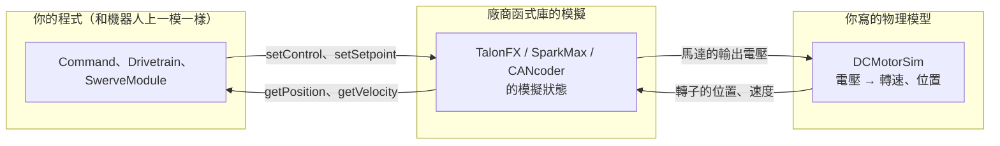

# 模擬怎麼運作

--8<-- "alpha-warning.md"

## 這頁學什麼

- 模擬時，程式的哪些部分是真的、哪些是假的
- `RobotBase.isSimulation()` 和 `simulationPeriodic()`
- 啟動模擬、用 Sim GUI 啟用機器人、接手把

## 觀念

### 哪些是真的、哪些是假的



- **你的程式**：完全不用改。`setControl()`、`getVelocity()` 照常呼叫
- **廠商的模擬**：Phoenix 6 和 REVLib 都會在電腦上執行和馬達控制器韌體一樣的邏輯，包括 PID、Feedforward、電流限制。它們算出「馬達現在輸出多少電壓」
- **物理模型**：廠商不知道你的馬達接了什麼機構。你要告訴它：這個電壓會讓輪子轉多快。這就是 **`DCMotorSim`** 的工作

### 程式怎麼知道自己在模擬

```java
if (RobotBase.isSimulation()) {
  // 只在電腦上模擬時執行
}
```

Subsystem 除了 `periodic()`，還有一個 **`simulationPeriodic()`**：它只在模擬時被呼叫，每 20 ms 一次，在 `periodic()` 之後。物理模型的更新都放在這裡，部署到機器人上時完全不會執行。

## 步驟

### 啟動模擬

1. 在 VS Code 按 ++ctrl+shift+p++，選 **WPILib: Simulate Robot Code**
2. 選擇 **Sim GUI**，按 **OK**
3. 程式編譯後，會打開 **Robot Simulation** 視窗

專案的 `build.gradle` 裡已經有這兩行（WPILib 範本預設就有），所以不用另外設定：

```groovy
wpi.sim.addGui().defaultEnabled = true
wpi.sim.addDriverstation()
```

!!! info "剛開始的 CAN 錯誤"
    模擬剛啟動時，輸出視窗可能會出現幾行 `Error -1003: CAN frame not received/too-stale`。這是模擬的 CTRE 裝置還在啟動，之後不再出現就沒關係。

### 用 Sim GUI 啟用機器人

Sim GUI 裡有幾個重要的視窗：

| 視窗 | 用途 |
| --- | --- |
| **Robot State** | 切換 Disabled、Autonomous、Teleoperated，和 Driver Station 一樣 |
| **System Joysticks** | 電腦偵測到的手把和鍵盤 |
| **Joysticks** | 程式看到的手把，Joystick[0] 就是 `DRIVER_CONTROLLER_PORT = 0` |

1. **接上手把**（USB 的 Xbox 手把最方便）
2. 把 **System Joysticks** 裡的手把**拖到** **Joysticks** 的 Joystick[0]
3. 在 **Robot State** 點 **Teleoperated**（Teleop）

沒有手把的話，也可以把 System Joysticks 裡的 **Keyboard 0** 拖到 Joystick[0]，用鍵盤模擬搖桿。哪些按鍵對應到哪個搖桿軸，可以在 Sim GUI 的鍵盤設定裡查看和修改。

!!! tip "小技巧：用 Driver Station 代替 Sim GUI"
    選擇模擬的時候也可以勾選 **Use Real DriverStation**，用真正的 FRC Driver Station 程式控制模擬的機器人，手把的設定和比賽時一樣。

## 常見錯誤

!!! bug "常見錯誤：Joysticks 裡沒有手把"
    手把出現在 System Joysticks，但沒有拖到 Joysticks 的 Joystick[0]，程式讀到的搖桿永遠是 0，機器人不會動。

!!! bug "常見錯誤：在 `periodic()` 裡更新物理模型"
    物理模型放在 `periodic()`，部署到機器人上時也會執行。雖然模擬的裝置在真正的機器人上不會有作用，但會浪費時間，而且很容易不小心把模擬的值當成真的。物理模型一律放在 `simulationPeriodic()`。

## 小練習

1. 用[第 13 章](../13-swerve-drive/index.md) 的程式（還沒加模擬）啟動模擬，啟用 Teleop 推搖桿。`ModuleVelocities` 會變嗎？為什麼？
2. 在 `Drivetrain` 的 `simulationPeriodic()` 裡用 `System.out.println` 印一行字，部署到真正的機器人上（或用 `RobotBase.isReal()` 想一想），會印出來嗎？

??? question "第 1 題參考答案"
    不會變。程式有送出指令，但沒有物理模型告訴模擬的 TalonFX 和 CANcoder「輪子轉了」，所以讀到的速度和角度一直是 0。[下一頁](module-sim.md) 會加上物理模型。

??? question "第 2 題參考答案"
    不會。`simulationPeriodic()` 只在模擬時被 Command Scheduler 呼叫，在真正的機器人上（`RobotBase.isReal()` 為 `true`）不會執行。
