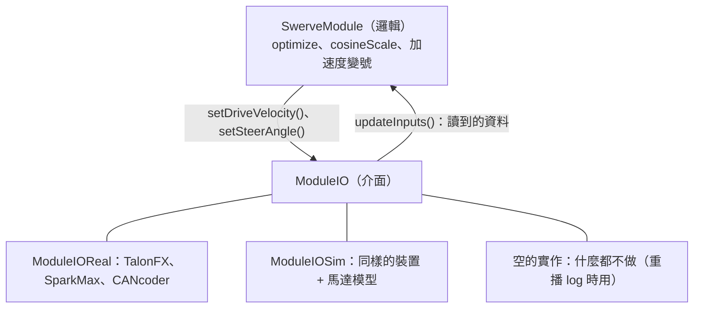

# 硬體抽象化

--8<-- "alpha-warning.md"

## 這頁學什麼

- 為什麼要把「和硬體溝通」和「決定要做什麼」分開
- 硬體抽象化的三個部分：介面、輸入資料、實作
- 哪些東西放在硬體那一邊、哪些放在邏輯這一邊
- 為什麼叫 `ModuleIO`

## 觀念

### 混在一起的問題

[第 17 章的 `SwerveModule`](../17-swerve-advanced/acceleration-ff.md#swervemodule) 裡，同一個類別同時：

- 建立並設定 TalonFX、SparkMax、CANcoder
- 讀 CANcoder 的角度
- 判斷要不要 `optimize`、加速度要不要變號
- 模擬時，還要更新馬達模型

想在電腦上跑這段邏輯，就一定要有 TalonFX、SparkMax 的物件（或它們的模擬）。想在沒有任何硬體的情況下，只用「一份記錄下來的數字」重新跑一次這段邏輯，是做不到的。

### 用介面分開

[第 1 章](../01-java/inheritance.md#interface介面約定能做什麼) 用 `SimpleMotor` 介面講過：程式只依賴「能做什麼」，不在乎背後是哪一種馬達。硬體抽象化就是把這個想法用在整個模組上：



硬體抽象化有三個部分：

| 部分 | 這一章的例子 | 內容 |
| --- | --- | --- |
| **介面** | `ModuleIO` | 硬體「能做什麼」：讀取資料、送出指令 |
| **輸入資料 (Inputs)** | `ModuleIOInputs` | 一個只裝資料的類別：每 20 ms 從硬體讀到的**所有**數值 |
| **實作** | `ModuleIOReal`、`ModuleIOSim` | 實際和硬體（或模擬）溝通的程式 |

### 輸入資料是唯一的入口

最重要的規則是：**邏輯讀到的所有感測器資料，都要經過輸入資料**。

```java
// 每 20 ms
io.updateInputs(inputs);              // 硬體把讀到的數值寫進 inputs
Rotation2d angle = inputs.steerAngle; // 邏輯只讀 inputs，不直接讀 CANcoder
```

這樣做之後，邏輯完全不知道 `inputs` 裡的數字是怎麼來的。可能是：

- 真的 CANcoder 讀到的（比賽時）
- 馬達模型算出來的（模擬時）
- **從 log 檔讀出來的**（重播時）

只要 `inputs` 一樣，邏輯算出的結果就一樣。[Log replay](replay.md) 就是靠這一點。

### 哪些放在哪一邊

| 放在硬體那一邊（`ModuleIOReal`） | 放在邏輯這一邊（`SwerveModule`） |
| --- | --- |
| 建立、設定馬達控制器和感測器 | `optimize`、`cosineScale` |
| 單位換算：馬達圈數 → 公尺、圈 → `Rotation2d` | 決定目標速度和角度 |
| 馬達控制器內建的 PID（設定 kP、kV 送進控制器） | Odometry、Setpoint Generator |
| 讀取感測器、送出指令 | 判斷、計算、記錄目標值 |

一個簡單的判斷方法：**換一家廠商的馬達時要改的，放在硬體那一邊；不管用哪家馬達都一樣的，放在邏輯這一邊。**

### 為什麼叫 `ModuleIO`

IO 是 **Input/Output（輸入 / 輸出）** 的縮寫：硬體提供輸入（感測器的讀值），接收輸出（馬達的指令）。AdvantageKit 的官方文件和範本，以及 6328、254 等強隊的開源程式，都用 `XxxIO`、`XxxIOReal`、`XxxIOSim` 這種命名，這份教學也沿用，你在外面看到別人的程式時就能對得上。

### 預設方法：空的實作

介面的方法都寫成 **`default`**（有預設內容的方法），而且預設是**什麼都不做**：

```java
public interface ModuleIO {
  default void updateInputs(ModuleIOInputs inputs) {}
  default void setSteerAngle(Rotation2d angle) {}
  // ...
}
```

這樣 `new ModuleIO() {}` 就是一個「什麼都不做」的實作：不讀任何東西、不控制任何馬達。重播 log 時就用它，因為資料會從 log 檔來。`{}` 是 **Anonymous class（匿名類別）**：當場建立一個實作介面的物件，不用另外取名字。

## 常見錯誤

!!! bug "常見錯誤：邏輯裡直接讀硬體"
    在 `SwerveModule` 或 `Drivetrain` 裡直接呼叫 `encoder.getAbsolutePosition()`，或是用 `new OnboardIMU()` 讀朝向。這些讀值沒有經過輸入資料，重播時讀不到，邏輯就會算出不一樣的結果。**所有感測器都要經過 IO**。

!!! bug "常見錯誤：把判斷寫在 IO 裡"
    在 `ModuleIOReal.setSteerAngle()` 裡做 `optimize`。這樣模擬和重播時要再寫一次，而且重播時 `ModuleIO` 是空的，這段判斷根本不會執行。IO 只負責「照做」，判斷都放在邏輯那一邊。

## 小練習

1. 第 8 章的 Shooter 有一顆馬達和一個轉速的讀值。照這頁的方法，`ShooterIO` 的介面和 `ShooterIOInputs` 應該有哪些東西？
2. 為什麼單位換算放在 IO 那一邊，而不是邏輯這一邊？
3. 「空的實作」除了重播之外，還可以用在什麼時候？

??? question "第 1 題參考答案"
    ```java
    public interface ShooterIO {
      @AutoLog
      class ShooterIOInputs {
        public double velocityRpm = 0.0;
        public double appliedVolts = 0.0;
        public double currentAmps = 0.0;
      }

      default void updateInputs(ShooterIOInputs inputs) {}

      /** 用速度控制轉到指定的轉速。 */
      default void setVelocity(double rpm) {}

      default void stop() {}
    }
    ```

    `isAtSpeed()`（轉速有沒有到）是判斷，放在 `Shooter` Subsystem 裡，用 `inputs.velocityRpm` 計算。

??? question "第 2 題參考答案"
    不同廠商的單位不一樣：REV 的速度是 RPM、CTRE 是每秒轉數，REVLib 2027 還沒有換算係數。把換算放在 IO 裡，邏輯拿到的永遠是公尺、公尺 / 秒、`Rotation2d`，換廠商時只要改 IO，邏輯完全不用動。

??? question "第 3 題參考答案"
    機器人上**還沒裝好**的機構。例如手臂的馬達還沒接線，可以先用 `new ArmIO() {}`，程式其他部分照樣能部署、測試，不會因為找不到 CAN 裝置而一直報錯。
