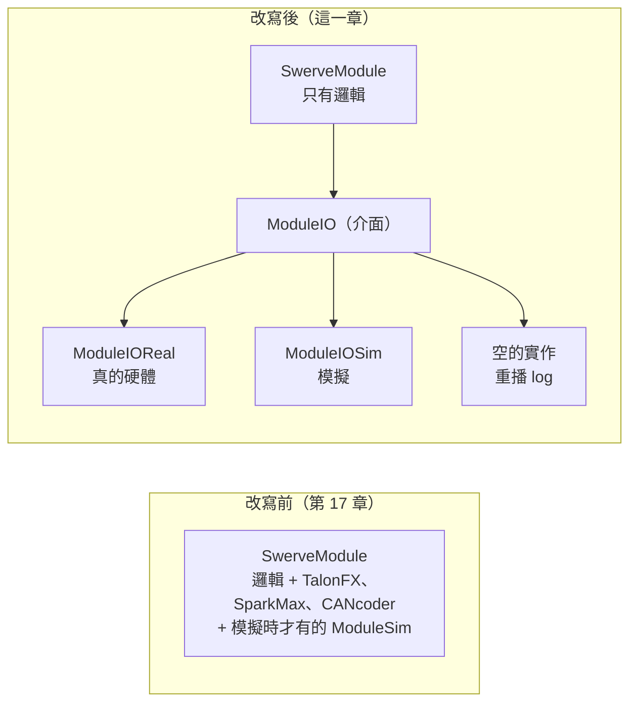

# 第 18 章 硬體抽象化與 AdvantageKit

--8<-- "alpha-warning.md"

到目前為止，`SwerveModule` 同時做兩件事：**和硬體溝通**（設定 TalonFX、讀 CANcoder），以及**決定要做什麼**（Optimize、Cosine 補償、加速度的正負號）。[第 15 章](../15-swerve-sim/module-sim.md) 加模擬的時候，就只能在裡面塞一個「只有模擬時才建立、真的機器人上是 `null`」的 `ModuleSim`。

這一章把這兩件事分開：**Hardware abstraction（硬體抽象化）**。硬體的部分藏在一個介面後面，Subsystem 只剩邏輯，不知道底下接的是真的馬達、模擬，還是**一份 log 檔**。最後這一種就是 **AdvantageKit** 最強大的功能：**Log replay（重播）**。比賽中出了問題，把 log 拿回電腦，用改過的程式重新跑一次，看看修正有沒有效。

這是 6328（AdvantageKit 的開發者）、254 等強隊的程式都在用的架構。學會之後，看強隊開源的程式會容易很多。

## 這章學什麼

- 硬體抽象化：介面（`ModuleIO`）、輸入資料（`ModuleIOInputs`）、多個實作
- 把[第 17 章](../17-swerve-advanced/index.md) 的 Swerve 改寫成這種架構
- 安裝 AdvantageKit，用 `@AutoLog` 和 `Logger` 記錄所有資料
- Log replay：重播一份 log，比較改程式前後的差別

**需要先讀**：[第 1 章 繼承與介面](../01-java/inheritance.md)、[第 15 章 Swerve 模擬](../15-swerve-sim/index.md)、[第 17 章 Swerve 進階](../17-swerve-advanced/index.md)。這一章的程式是在第 17 章最後的版本上修改

## 改寫前後

## 本章內容

| 小節 | 內容 |
| --- | --- |
| [硬體抽象化](concept.md) | 為什麼要分開、介面和輸入資料、哪些東西放在哪裡 |
| [改寫 Swerve](swerve-io.md) | `ModuleIO`、`GyroIO` 和它們的實作，改寫後的 `SwerveModule`、`Drivetrain` |
| [AdvantageKit](advantagekit.md) | 安裝、`LoggedRobot`、`@AutoLog`、`Logger` |
| [Log replay](replay.md) | 重播一份 log、比較結果、哪些寫法會讓重播失準 |
| [延伸學習](further.md) | 視覺的硬體抽象化、WPILib 的 Epilogue、更多參考 |
