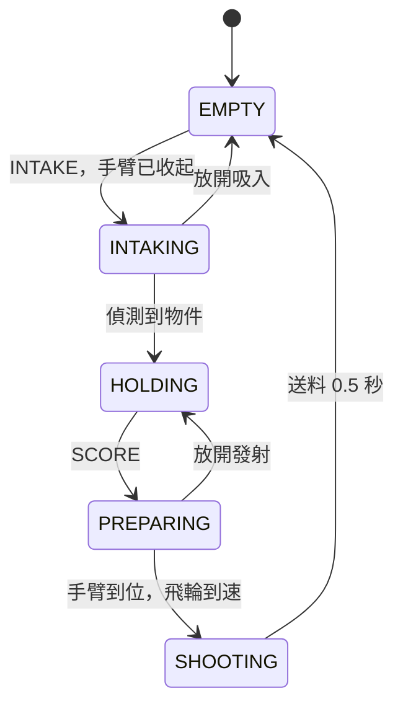
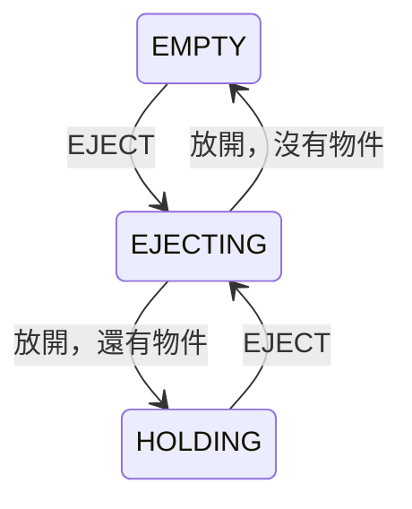

# 狀態機

--8<-- "alpha-warning.md"

## 這頁學什麼

- 狀態機的三個部分：狀態、轉換、每個狀態的輸出
- 畫出 Intake、Arm、Shooter 的狀態圖
- 「想要的狀態」和「目前的狀態」為什麼要分開
- 畫好狀態圖之後，怎麼檢查有沒有漏掉的情況

## 觀念

### 狀態、轉換、輸出

[第 5 章的延伸學習](../05-commands/further.md#state-machine狀態機) 簡單介紹過 **State machine（狀態機）**：機器人在任何時候都處於**某一個**狀態，特定的條件成立時，轉換到另一個狀態。

一個狀態機有三個部分：

| 部分 | 意思 | 這一章的例子 |
| --- | --- | --- |
| **State（狀態）** | 機器人現在在做什麼，任何時候只有一個 | `HOLDING`：拿著物件、手臂收起 |
| **Transition（轉換）** | 什麼條件成立時，換到哪一個狀態 | 在 `PREPARING` 時，手臂到位而且飛輪到速 → `SHOOTING` |
| **Output（輸出）** | 在這個狀態下，每個機構要做什麼 | `SHOOTING`：手臂在發射角度、飛輪轉、Intake 送料 |

### 這一章的狀態

| 狀態 | 意思 | 手臂 | Intake | Shooter |
| --- | --- | --- | --- | --- |
| `EMPTY` | 沒有物件 | 收起 | 停 | 停 |
| `INTAKING` | 正在吸 | 收起 | 吸入 | 停 |
| `HOLDING` | 拿著物件 | 收起 | 停 | 停 |
| `PREPARING` | 準備發射：等手臂和飛輪 | 發射角度 | 停 | 轉 |
| `SHOOTING` | 送料中 | 發射角度 | 送料 | 轉 |
| `EJECTING` | 吐出 | 收起 | 反轉 | 停 |

注意每一列都把**三個機構**的輸出寫滿了。狀態機的好處之一就是：在任何狀態下，每個機構該做什麼都是確定的，不會有「手臂沒人管」的時候。

### 想要的狀態和目前的狀態

駕駛按按鈕的時候，表達的是「**我想要**發射」，不是「現在立刻送料」。手臂可能還沒轉上去，或者根本沒有物件可以發射。

所以這一章把兩件事分開：

| | 誰決定 | 這一章的名稱 |
| --- | --- | --- |
| **想要的狀態 (Goal)** | 駕駛的按鈕、自動程式 | `IDLE`、`INTAKE`、`SCORE`、`EJECT` |
| **目前的狀態 (State)** | 狀態機根據想要的狀態**和感測器**決定 | 上面表格裡的六個 |

按鈕只改變 Goal，**State 由狀態機自己決定什麼時候能轉換**：

- 沒有物件時按住發射（Goal = `SCORE`）：State 停在 `EMPTY`，因為沒東西可以發射
- 在 `PREPARING` 時放開發射（Goal 回到 `IDLE`）：State 回到 `HOLDING`，物件還在，手臂收回來
- 在 `SHOOTING` 時放開發射：State **不理會**，一定把送料做完，免得物件卡在一半

這就是[上一頁](commands.md#這個做法的極限) 想做卻很難做的事：放開按鈕可以取消，但送料一旦開始就不能取消。

### 狀態圖

先畫最主要的流程：吸入、拿著、準備、發射。



再加上吐出。吐出可以從 `EMPTY` 或 `HOLDING` 開始，放開之後依照還有沒有物件決定回到哪裡：



圖上的 `INTAKE`、`SCORE`、`EJECT` 是 Goal，「放開」是 Goal 回到 `IDLE`。「物件不見了」和「偵測到物件」這兩種跟著感測器變化的轉換沒有畫在圖上，免得線太多，下面會說明。

幾個值得注意的轉換：

- **`EMPTY` → `INTAKING` 要等手臂收起**：手臂還在上面的時候按吸入，State 會停在 `EMPTY`（`EMPTY` 的輸出本來就是收起手臂），手臂到了才開始吸
- **`HOLDING`、`PREPARING` 時物件不見了 → `EMPTY`**：被撞掉、或光遮斷感測器誤判時，回到 `EMPTY`，不會對著空氣送料
- **`SHOOTING` 時物件不見了是正常的**：射出去了。所以 `SHOOTING` 只看時間，不看感測器。同一個感測器的變化，在不同的狀態有不同的意思
- **`EMPTY` 時偵測到物件 → `HOLDING`**：開機時就預載了物件（自動階段），或駕駛手動塞進去，不用經過 `INTAKING`

### 畫好之後，檢查每一格

狀態圖最大的用處是**檢查漏掉的情況**。把每個狀態和每個 Goal 排成一張表，每一格都要有答案：

| 狀態 ＼ Goal | `IDLE` | `INTAKE` | `SCORE` | `EJECT` |
| --- | --- | --- | --- | --- |
| `EMPTY` | 不變 | 手臂收起後 → `INTAKING` | 不變（沒東西） | → `EJECTING` |
| `INTAKING` | → `EMPTY` | 不變 | → `EMPTY` | → `EMPTY` |
| `HOLDING` | 不變 | 不變（已經有了） | → `PREPARING` | → `EJECTING` |
| `PREPARING` | → `HOLDING` | → `HOLDING` | 到位後 → `SHOOTING` | → `HOLDING` |
| `SHOOTING` | 送完 → `EMPTY` | 送完 → `EMPTY` | 送完 → `EMPTY` | 送完 → `EMPTY` |
| `EJECTING` | → `HOLDING` 或 `EMPTY` | → `HOLDING` 或 `EMPTY` | → `HOLDING` 或 `EMPTY` | 不變 |

（還要加上感測器的變化：任何時候偵測到物件出現或不見，表上已經寫在狀態圖裡了。）

填表的時候你會發現一些要做決定的地方。例如 `INTAKING` 時 Goal 變成 `EJECT`：這張表選擇先回到 `EMPTY`，下一次迴圈再從 `EMPTY` 轉到 `EJECTING`。也可以直接轉到 `EJECTING`，兩種都可以，**重點是你有想過**。

[第 5 章](../05-commands/further.md#state-machine狀態機) 問過「Holding 狀態下又按了 faceDown 要怎麼辦？」，這張表的答案是：不變，已經有物件了就不再吸。

## 常見錯誤

!!! bug "常見錯誤：把「條件」當成「狀態」"
    寫出 `ARM_AT_SCORE`、`SHOOTER_AT_SPEED` 這種狀態。手臂到位、飛輪到速是**感測器讀到的條件**，它們決定**要不要轉換**，不是機器人「正在做的事」。狀態應該是一個階段，例如 `PREPARING`（正在等手臂和飛輪）。

!!! bug "常見錯誤：每個狀態只寫了一部分機構的輸出"
    `PREPARING` 只寫了手臂和飛輪，沒寫 Intake。Intake 就會維持上一個狀態留下來的輸出，例如 `EJECTING` 時的反轉。每個狀態都要把**所有**機構的輸出寫滿。

!!! bug "常見錯誤：狀態太多"
    把「手臂轉到 30 度」「手臂轉到 60 度」「手臂轉到 90 度」都做成狀態。狀態是**駕駛和你在乎的階段**，不是每一個中間位置。如果兩個狀態的轉換條件完全一樣、只是輸出的數字不同，通常可以合併成一個狀態，數字另外存。

## 小練習

1. 加一個 Goal `PREPARE`：按住時手臂轉上去、飛輪加速，但不送料；這時再按住 `SCORE` 才送料。要加新的狀態嗎？狀態圖要改哪些地方？
2. 你們的 Intake 吸到物件後，要再往裡面送一點，物件才會停在 Shooter 前面（很多機器人都有這一步，叫 **Indexing**）。在狀態圖上加上這一步。
3. 填表時，`PREPARING` 遇到 Goal = `INTAKE` 選擇回到 `HOLDING`。有沒有其他合理的選擇？

??? question "第 1 題參考答案"
    不用新的狀態。`PREPARING` 的輸出正好就是「手臂轉上去、飛輪加速、不送料」，只要改轉換條件：

    - `HOLDING` → `PREPARING`：Goal 是 `PREPARE` **或** `SCORE`
    - `PREPARING` → `SHOOTING`：Goal 是 `SCORE`，而且手臂到位、飛輪到速
    - `PREPARING` → `HOLDING`：Goal 既不是 `PREPARE` 也不是 `SCORE`

    駕駛就可以在開往得分區的路上先按住 `PREPARE`，到了再按 `SCORE`，一按就送料，不用再等手臂和飛輪。

??? question "第 2 題參考答案"
    在 `INTAKING` 和 `HOLDING` 中間加一個 `INDEXING`：

    ```mermaid
    stateDiagram-v2
        INTAKING --> INDEXING: 第一個感測器偵測到物件
        INDEXING --> HOLDING: 第二個感測器偵測到物件<br/>（物件到 Shooter 前面了）
    ```

    `INDEXING` 的輸出是 Intake 慢速往內送，而且**不理會 Goal**（和 `SHOOTING` 一樣），避免物件停在一半。通常需要第二個感測器，或用時間代替。

??? question "第 3 題參考答案"
    也可以選擇「不變」：手上已經有物件，吸入沒有意義，所以忽略這個 Goal、繼續準備發射。兩種都合理：

    - 回到 `HOLDING`：駕駛放開發射、改按吸入，通常代表「不想射了」，手臂收回來比較安全
    - 不變：避免駕駛誤觸時打斷發射

    沒有標準答案，跟駕駛討論他們的習慣，然後**寫進測試**（[測試狀態機](testing.md)），之後改程式時才不會不小心改掉。
