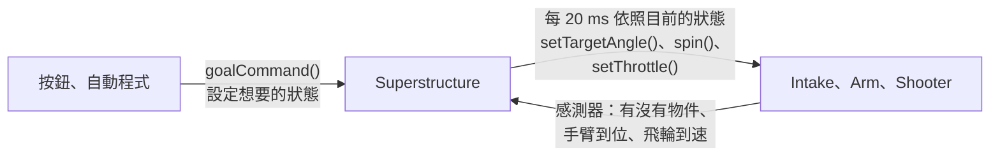

# 做法二：Superstructure

--8<-- "alpha-warning.md"

## 這頁學什麼

- 寫一個 `Superstructure` Subsystem，用狀態機協調 Intake、Arm、Shooter
- 把狀態轉換寫成一個**不碰硬體**的方法，方便測試
- 按鈕只設定「想要的狀態」
- 在 Dashboard 上看到目前的狀態

## 觀念

### 誰來控制機構

[做法一](commands.md) 裡，每個 Command 各自控制機構，Scheduler 用 Requirements 決定誰能用。這一頁換一個方式：**只有 `Superstructure` 控制 Intake、Arm、Shooter**。



`Superstructure` 每 20 ms 在 `periodic()` 裡做三件事：

1. **讀感測器**：把需要的資料收集成一個 `Inputs`
2. **決定狀態**：`nextState(目前的狀態, 想要的狀態, Inputs)` 算出下一個狀態
3. **送出輸出**：依照狀態，告訴三個機構要做什麼

### 機構要能「直接」控制

`Superstructure` 每 20 ms 直接呼叫機構的方法，不是排程 Command。所以 Arm 和 Shooter 要有「做一次」的方法：

| 機構 | 原本只有 | 要加上 |
| --- | --- | --- |
| Arm | `goToAngleCommand(degrees)` | `setTargetAngle(degrees)`：送一次目標角度和重力補償 |
| Shooter | `spinCommand()` | `spin()`、`stop()` |
| Intake | 已經有 `setThrottle()`、`stop()` | 不用改 |

原本的 Command 改成呼叫這些新方法，行為完全一樣。

### 狀態轉換不碰硬體

`nextState()` 是一個 `static` 方法，只看傳進去的參數：

```java
public static State nextState(State state, Goal goal, Inputs in)
```

它不讀編碼器、不碰馬達，同樣的參數永遠算出同樣的結果。這樣做有兩個好處：

- **好讀**：所有轉換規則集中在一個地方，和[狀態圖](state-machine.md#狀態圖) 一條一條對得上
- **好測試**：不需要機器人，也不需要模擬馬達，就能檢查每一種情況（[下一頁](testing.md)）

這和[第 18 章](../18-hardware-abstraction/concept.md) 把「和硬體溝通」和「決定要做什麼」分開，是同一個想法。

## 範例

### Arm 和 Shooter：加上直接控制的方法

=== "REV"

    `Arm`：把 `goToAngleCommand` 裡送目標的那段搬到 `setTargetAngle`：

    ```java
        /** 轉到指定角度。每 20 ms 呼叫一次，重力補償才會跟著角度更新。 */
        public void setTargetAngle(double degrees) {
          double target = Math.clamp(degrees, ArmConstants.STOWED_ANGLE_DEGREES, ArmConstants.MAX_ANGLE_DEGREES);
          controller.setSetpoint(
              toEncoderRotations(target),
              ControlType.kMAXMotionPositionControl,
              ClosedLoopSlot.kSlot0,
              gravityVolts(),
              ArbFFUnits.kVoltage);
        }

        /** 轉到指定角度，並一直停在那裡。 */
        public Command goToAngleCommand(double degrees) {
          return run(() -> setTargetAngle(degrees)).withName("ArmToAngle");
        }
    ```

    `Shooter`：

    ```java
        /** 用速度控制轉到 TARGET_RPM。 */
        public void spin() {
          controller.setSetpoint(ShooterConstants.TARGET_RPM, ControlType.kVelocity);
        }

        public void stop() {
          motor.stopMotor();
        }

        /** 維持在 TARGET_RPM，結束時停止。 */
        public Command spinCommand() {
          return startEnd(this::spin, this::stop).withName("Spin");
        }
    ```

=== "CTRE"

    `Arm`：把 `goToAngleCommand` 裡送目標的那段搬到 `setTargetAngle`：

    ```java
        /** 轉到指定角度。每 20 ms 呼叫一次，重力補償才會跟著角度更新。 */
        public void setTargetAngle(double degrees) {
          double target = Math.clamp(degrees, ArmConstants.STOWED_ANGLE_DEGREES, ArmConstants.MAX_ANGLE_DEGREES);
          motor.setControl(
              motionRequest.withPosition(toEncoderRotations(target)).withFeedForward(gravityVolts()));
        }

        /** 轉到指定角度，並一直停在那裡。 */
        public Command goToAngleCommand(double degrees) {
          return run(() -> setTargetAngle(degrees)).withName("ArmToAngle");
        }
    ```

    `Shooter`：

    ```java
        /** 用速度控制轉到 TARGET_RPM。 */
        public void spin() {
          motor.setControl(velocityRequest.withVelocity(ShooterConstants.TARGET_RPM / 60.0));
        }

        public void stop() {
          motor.stopMotor();
        }

        /** 維持在 TARGET_RPM，結束時停止。 */
        public Command spinCommand() {
          return startEnd(this::spin, this::stop).withName("Spin");
        }
    ```

`setTargetAngle` 要**每 20 ms 都呼叫**，不能只呼叫一次：重力補償的電壓要跟著手臂目前的角度更新（[第 8 章](../08-control/motion-profile.md#常見錯誤) 的 `runOnce` 問題）。`Superstructure` 的 `periodic()` 本來就每 20 ms 執行，剛好符合。

### Superstructure

```java title="src/main/java/first/robot/subsystems/Superstructure.java"
package first.robot.subsystems;

import first.robot.Constants.ArmConstants;
import first.robot.Constants.IntakeConstants;
import first.robot.Constants.ShooterConstants;
import org.wpilib.command2.Command;
import org.wpilib.command2.SubsystemBase;
import org.wpilib.system.Timer;
import org.wpilib.telemetry.Telemetry;

/** 協調 Intake、Arm、Shooter 的狀態機。 */
public class Superstructure extends SubsystemBase {
  /** 想要的狀態：駕駛（或自動程式）希望機器人做什麼。 */
  public enum Goal {
    IDLE,
    INTAKE,
    SCORE,
    EJECT
  }

  /** 目前的狀態：機器人實際上正在做什麼。 */
  public enum State {
    EMPTY,
    INTAKING,
    HOLDING,
    PREPARING,
    SHOOTING,
    EJECTING
  }

  /** 判斷要不要轉換狀態時，需要知道的感測器資料。 */
  public record Inputs(
      boolean hasGamePiece,
      boolean armAtStow,
      boolean armAtScore,
      boolean shooterAtSpeed,
      double secondsInState) {}

  private final Intake intake;
  private final Arm arm;
  private final Shooter shooter;

  private Goal goal = Goal.IDLE;
  private State state = State.EMPTY;
  private final Timer stateTimer = new Timer();

  public Superstructure(Intake intake, Arm arm, Shooter shooter) {
    this.intake = intake;
    this.arm = arm;
    this.shooter = shooter;
    stateTimer.start();
  }

  /** 狀態轉換：只看目前的狀態、想要的狀態和感測器，不碰任何硬體。 */
  public static State nextState(State state, Goal goal, Inputs in) {
    return switch (state) {
      case EMPTY -> {
        if (in.hasGamePiece()) yield State.HOLDING;
        if (goal == Goal.INTAKE && in.armAtStow()) yield State.INTAKING;
        if (goal == Goal.EJECT) yield State.EJECTING;
        yield State.EMPTY;
      }
      case INTAKING -> {
        if (in.hasGamePiece()) yield State.HOLDING;
        if (goal != Goal.INTAKE) yield State.EMPTY;
        yield State.INTAKING;
      }
      case HOLDING -> {
        if (!in.hasGamePiece()) yield State.EMPTY;
        if (goal == Goal.SCORE) yield State.PREPARING;
        if (goal == Goal.EJECT) yield State.EJECTING;
        yield State.HOLDING;
      }
      case PREPARING -> {
        if (!in.hasGamePiece()) yield State.EMPTY;
        if (goal != Goal.SCORE) yield State.HOLDING;
        if (in.armAtScore() && in.shooterAtSpeed()) yield State.SHOOTING;
        yield State.PREPARING;
      }
      // 開始送料之後就一定做完，放開按鈕也不會停在一半
      case SHOOTING -> in.secondsInState() >= ShooterConstants.FEED_SECONDS ? State.EMPTY : State.SHOOTING;
      case EJECTING -> {
        if (goal != Goal.EJECT) yield in.hasGamePiece() ? State.HOLDING : State.EMPTY;
        yield State.EJECTING;
      }
    };
  }

  /** 每個狀態下，三個機構各自要做什麼。 */
  private void applyOutputs() {
    switch (state) {
      case EMPTY, HOLDING -> {
        arm.setTargetAngle(ArmConstants.STOWED_ANGLE_DEGREES);
        intake.stop();
        shooter.stop();
      }
      case INTAKING -> {
        arm.setTargetAngle(ArmConstants.STOWED_ANGLE_DEGREES);
        intake.setThrottle(IntakeConstants.INTAKE_THROTTLE);
        shooter.stop();
      }
      case PREPARING -> {
        arm.setTargetAngle(ArmConstants.SCORE_ANGLE_DEGREES);
        intake.stop();
        shooter.spin();
      }
      case SHOOTING -> {
        arm.setTargetAngle(ArmConstants.SCORE_ANGLE_DEGREES);
        intake.setThrottle(IntakeConstants.INTAKE_THROTTLE);
        shooter.spin();
      }
      case EJECTING -> {
        arm.setTargetAngle(ArmConstants.STOWED_ANGLE_DEGREES);
        intake.setThrottle(IntakeConstants.EJECT_THROTTLE);
        shooter.stop();
      }
    }
  }

  @Override
  public void periodic() {
    Inputs inputs = new Inputs(
        intake.hasGamePiece(),
        arm.isAtAngle(ArmConstants.STOWED_ANGLE_DEGREES),
        arm.isAtAngle(ArmConstants.SCORE_ANGLE_DEGREES),
        shooter.isAtSpeed(),
        stateTimer.get());

    State next = nextState(state, goal, inputs);
    if (next != state) {
      state = next;
      stateTimer.reset();
    }
    applyOutputs();

    Telemetry.log("Superstructure/Goal", goal.name());
    Telemetry.log("Superstructure/State", state.name());
  }

  public State getState() {
    return state;
  }

  /** 執行期間把想要的狀態設成 wanted，結束時回到 IDLE。 */
  public Command goalCommand(Goal wanted) {
    return startEnd(() -> goal = wanted, () -> goal = Goal.IDLE).withName("Goal " + wanted);
  }
}
```

幾個新的寫法：

- **`record Inputs(...)`**：一次裝好幾個值的資料類別（[第 1 章的延伸學習](../01-java/further.md#record簡單的資料類別)）。用 `in.hasGamePiece()` 讀出裡面的值
- **`switch` 和 `yield`**：`switch` 的每個 `case` 算出一個值，整個 `switch` 的結果就是 `nextState()` 的回傳值。`case` 的大括號裡要用 **`yield`** 交出這個值（不是 `return`）；像 `SHOOTING` 那樣只有一行的，直接寫在 `->` 後面
- **`case EMPTY, HOLDING ->`**：兩個狀態的輸出一樣，寫在同一個 `case`
- **`stateTimer`**：每次轉換狀態都歸零，所以 `secondsInState` 是「進入這個狀態多久了」。`SHOOTING` 用它決定送料什麼時候結束
- **`goalCommand()`**：`startEnd` 在開始時設定 Goal，結束（放開按鈕、被別的 Goal 中斷）時回到 `IDLE`。它的 Requirement 是 `Superstructure`，所以同一時間只會有一個 Goal

因為 `nextState()` 用的是 `switch`，以後在 `State` 加了新的狀態卻忘了處理，**編譯就會失敗**，不會等到上場才發現。

### RobotContainer

```java title="src/main/java/first/robot/RobotContainer.java"
package first.robot;

import first.robot.Constants.OperatorConstants;
import first.robot.commands.TurnToAngle;
import first.robot.subsystems.Arm;
import first.robot.subsystems.Drivetrain;
import first.robot.subsystems.Intake;
import first.robot.subsystems.Shooter;
import first.robot.subsystems.Superstructure;
import first.robot.subsystems.Superstructure.Goal;
import first.robot.subsystems.Superstructure.State;
import org.wpilib.command2.Command;
import org.wpilib.command2.Commands;
import org.wpilib.command2.button.CommandGamepad;
import org.wpilib.command2.button.Trigger;
import org.wpilib.math.filter.SlewRateLimiter;

public class RobotContainer {
  private final Drivetrain drivetrain = new Drivetrain();
  private final Intake intake = new Intake();
  private final Shooter shooter = new Shooter();
  private final Arm arm = new Arm();
  private final Superstructure superstructure = new Superstructure(intake, arm, shooter);

  private final CommandGamepad driver = new CommandGamepad(OperatorConstants.DRIVER_CONTROLLER_PORT);
  private final SlewRateLimiter forwardLimiter = new SlewRateLimiter(3.0);

  public RobotContainer() {
    configureDefaultCommands();
    configureBindings();
  }

  private void configureDefaultCommands() {
    drivetrain.setDefaultCommand(
        drivetrain.arcadeDriveCommand(
            () -> forwardLimiter.calculate(-driver.getLeftY()), () -> -driver.getRightX()));
    // Intake、Arm、Shooter 交給 Superstructure 控制，不設 default command
  }

  private void configureBindings() {
    driver.faceDown().whileTrue(superstructure.goalCommand(Goal.INTAKE));
    driver.rightBumper().whileTrue(superstructure.goalCommand(Goal.SCORE));
    driver.faceRight().whileTrue(superstructure.goalCommand(Goal.EJECT));

    driver.start().onTrue(drivetrain.resetHeadingCommand());
    driver.dpadUp().onTrue(new TurnToAngle(drivetrain, 0));
    driver.dpadLeft().onTrue(new TurnToAngle(drivetrain, 90));
    driver.dpadDown().onTrue(new TurnToAngle(drivetrain, 180));
    driver.dpadRight().onTrue(new TurnToAngle(drivetrain, -90));
    driver.leftBumper().whileTrue(
        drivetrain.arcadeDriveCommand(
            () -> -driver.getLeftY() * 0.3, () -> -driver.getRightX() * 0.3));

    new Trigger(() -> superstructure.getState() == State.HOLDING)
        .onTrue(Commands.print("拿到遊戲物件！"));
  }

  public Command getAutonomousCommand() {
    // 預載的遊戲物件：發射完（回到 EMPTY）才結束
    return superstructure.goalCommand(Goal.SCORE)
        .until(() -> superstructure.getState() == State.EMPTY)
        .withTimeout(3.0)
        .withName("ScorePreload");
  }
}
```

- 三個按鈕都用 `whileTrue`：按住就是「我想要」，放開就是「不要了」。`SHOOTING` 不理會 Goal，所以送料開始後放開按鈕也會射完
- 按住 `rightBumper` 的時候按 `faceDown`：`goalCommand(INTAKE)` 中斷 `goalCommand(SCORE)`，Goal 變成 `INTAKE`。最後按下的按鈕優先
- **Intake、Arm、Shooter 都沒有 Default command**：它們的馬達只由 `Superstructure` 控制
- 自動階段用的是**同一個** `goalCommand`，等到狀態回到 `EMPTY`（射完了）才結束。自動程式和駕駛用的是同一套規則，不會有「手動時正常、自動時打歪」的情況

## 動手看看

部署之後，在 AdvantageScope（或 Elastic）把 `Superstructure/Goal` 和 `Superstructure/State` 拉出來，一邊按按鈕一邊看：

- [ ] 沒有物件時按住 `rightBumper`：Goal 變成 `SCORE`，State 停在 `EMPTY`
- [ ] 手臂在上面時按住 `faceDown`：State 先停在 `EMPTY`，手臂收起後才變成 `INTAKING`
- [ ] 拿到物件後按住 `rightBumper`，在手臂到位前放開：State 從 `PREPARING` 回到 `HOLDING`
- [ ] 按住到發射：State 依序經過 `PREPARING` → `SHOOTING` → `EMPTY`

賽後看 log 時，把 State 放在折線圖最上面，就能一眼看出每個時間點機器人在做什麼。

## 常見錯誤

!!! bug "常見錯誤：機構還留著 Default command"
    第 8 章的 `intake.setDefaultCommand(intake.stopCommand())` 還在。`stopCommand()` 每 20 ms 呼叫一次 `stop()`，`Superstructure` 也每 20 ms 呼叫一次 `setThrottle()`，兩邊搶著控制同一顆馬達：Intake 會抖動，或完全不轉。改用 `Superstructure` 之後，三個機構的 Default command 和按鈕都要拿掉。

!!! bug "常見錯誤：轉換狀態時忘了把計時器歸零"
    `stateTimer` 沒有在轉換時 `reset()`，`secondsInState` 就是「開機到現在」。第一次進入 `SHOOTING` 時它早就超過 0.5 秒，送料一開始就結束。

!!! bug "常見錯誤：在 `nextState()` 裡讀感測器"
    在 `nextState()` 裡直接呼叫 `intake.hasGamePiece()`。這樣它就不能是 `static`，也不能不靠機器人測試。所有需要的資料都先放進 `Inputs`，再傳進去。

## 小練習

1. 拿到物件時讓手把震動 0.3 秒。（提示：`Trigger` 偵測 `State.HOLDING`，震動的寫法在[第 5 章 Trigger 的小練習](../05-commands/triggers.md#小練習)）
2. 把[狀態機那頁小練習第 1 題](state-machine.md#小練習) 的 `PREPARE` Goal 加進程式。
3. `Superstructure` 為什麼要把 `stateTimer` 的值放進 `Inputs`，而不是在 `nextState()` 裡呼叫 `stateTimer.get()`？

??? question "第 1 題參考答案"
    ```java
    new Trigger(() -> superstructure.getState() == State.HOLDING)
        .onTrue(Commands.startEnd(
                () -> driver.getHID().setRumble(RumbleType.LEFT_RUMBLE, 1.0),
                () -> driver.getHID().setRumble(RumbleType.LEFT_RUMBLE, 0.0))
            .withTimeout(0.3));
    ```

    `RumbleType` 要 `import org.wpilib.driverstation.GenericHID.RumbleType;`。和第 5 章不同的地方只有條件：第 5 章看的是感測器，這裡看的是狀態。所以從 `EJECTING` 回到 `HOLDING`（吐出時放開按鈕，物件還在）也會震動一次。

??? question "第 2 題參考答案"
    在 `Goal` 加上 `PREPARE`，修改 `HOLDING` 和 `PREPARING` 兩個 `case`：

    ```java
    case HOLDING -> {
      if (!in.hasGamePiece()) yield State.EMPTY;
      if (goal == Goal.PREPARE || goal == Goal.SCORE) yield State.PREPARING;
      if (goal == Goal.EJECT) yield State.EJECTING;
      yield State.HOLDING;
    }
    case PREPARING -> {
      if (!in.hasGamePiece()) yield State.EMPTY;
      if (goal != Goal.PREPARE && goal != Goal.SCORE) yield State.HOLDING;
      if (goal == Goal.SCORE && in.armAtScore() && in.shooterAtSpeed()) yield State.SHOOTING;
      yield State.PREPARING;
    }
    ```

    再綁一個按鈕：`driver.leftTrigger().whileTrue(superstructure.goalCommand(Goal.PREPARE));`

??? question "第 3 題參考答案"
    `nextState()` 是 `static`，本來就拿不到 `stateTimer` 這個欄位。更重要的是：時間也是一種「輸入」。放進 `Inputs`，測試時就能直接指定「已經在 `SHOOTING` 待了 0.1 秒」或「0.5 秒」，不用真的等。
